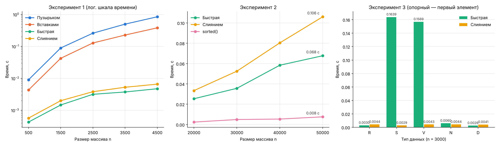

# Теория алгоритмов — лабораторные работы

**Насруллаев И. Р.** · направление 38.03.05 «Бизнес-информатика», 2 курс · вариант 0

| № | Тема | Отчёт | Программа |
|---|---|---|---|
| 1 | Итерационные методы вычисления элементарных функций: $\sqrt{a}$, $\sqrt[3]{b}$, $\ln c$ | [lab1/README.md](lab1/README.md) | [lr1.py](lab1/lr1.py) |
| 2 | Эмпирический анализ сложности сортировок. Часть 1: пузырьком и вставками | [lab2/README.md](lab2/README.md) | [lr2.py](lab2/lr2.py), [sorts_common.py](lab2/sorts_common.py) |
| 3 | Эмпирический анализ сложности сортировок. Часть 2: быстрая и слиянием | [lab3/README.md](lab3/README.md) | [lr3.py](lab3/lr3.py) |

Каждый отчёт содержит цель работы, задание, теорию, блок-схемы, листинг, таблицы результатов, графики, выводы и ответы на контрольные вопросы.

## Основные результаты

| Работа | Результат |
|---|---|
| ЛР № 1 | $\sqrt{2}$ — 5 итераций, $\sqrt[3]{10}$ — 8 итераций (метод Ньютона, погрешность $\sim 10^{-15}$); $\ln 5$ — 14 членов ряда (погрешность $9{,}25 \cdot 10^{-7}$) |
| ЛР № 2 | При удвоении $n$ время растёт в 3,9–4,3 раза (теория — 4); вставки быстрее пузырька в 2,1–2,2 раза |
| ЛР № 3 | При $n = 5000$ быстрая сортировка быстрее пузырька в 181 раз; $T(2n)/T(n) \approx 2{,}1$ (теория — 2,12); быстрая быстрее слияния в 1,6–1,7 раза |



## Структура репозитория

```
├── lab1/
│   ├── README.md          отчёт по ЛР № 1
│   ├── lr1.py             √a, ∛b (метод Ньютона), ln c (ряд)
│   └── results.txt        вывод программы
├── lab2/
│   ├── README.md          отчёт по ЛР № 2
│   ├── sorts_common.py    генерация данных и замер времени
│   ├── lr2.py             сортировка пузырьком и вставками
│   ├── lr2_plot.png       график T(n)
│   └── results.txt        вывод программы
├── lab3/
│   ├── README.md          отчёт по ЛР № 3
│   ├── lr3.py             быстрая сортировка и сортировка слиянием
│   ├── lr3_plot.png       графики экспериментов 1–3
│   └── results.txt        вывод программы
└── requirements.txt
```

## Как запустить

Нужен Python 3.10 или новее.

```bash
pip install -r requirements.txt
```

ЛР № 1 (только стандартная библиотека):

```bash
cd lab1
python lr1.py
```

ЛР № 2 и № 3 (замеры занимают меньше минуты, графики сохраняются в PNG рядом с программой):

```bash
cd lab2
python lr2.py
```

```bash
cd lab3
python lr3.py
```

Измерения в отчётах выполнены на Intel Core i5-12400F, 16 ГБ ОЗУ, Windows 10, Python 3.14.0.
