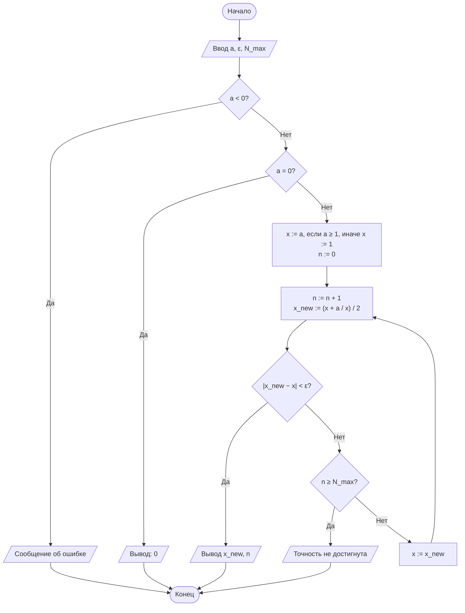
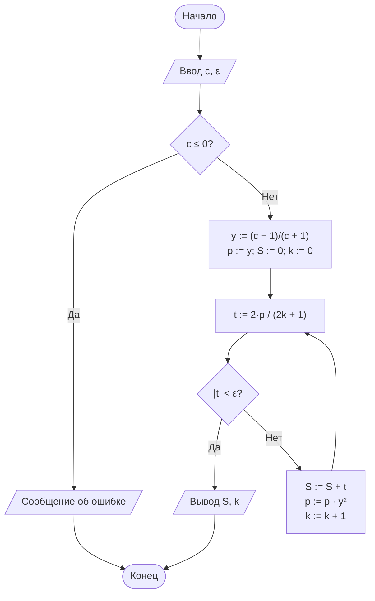

<div align="center">

**Дисциплина «Теория алгоритмов»**<br>
Направление подготовки 38.03.05 «Бизнес-информатика», 2 курс

# Отчёт по лабораторной работе № 1

### Итерационные методы вычисления элементарных функций: квадратный корень, кубический корень и натуральный логарифм

**Вариант 0**

Выполнил: студент группы ________ **Насруллаев И. Р.**<br>
Проверил: ________________

2026

</div>

---

## Содержание

1. [Цель и задачи работы](#1-цель-и-задачи-работы)
2. [Задание варианта](#2-задание-варианта)
3. [Краткие теоретические сведения](#3-краткие-теоретические-сведения)
4. [Блок-схемы алгоритмов](#4-блок-схемы-алгоритмов)
5. [Листинг программы](#5-листинг-программы)
6. [Результаты расчётов](#6-результаты-расчётов)
7. [Анализ результатов и выводы](#7-анализ-результатов-и-выводы)
8. [Ответы на контрольные вопросы](#8-ответы-на-контрольные-вопросы)

---

## 1. Цель и задачи работы

**Цель работы:** сформировать представление об итерационных алгоритмах как о классе вычислительных процедур, результат которых достигается последовательным уточнением приближений, и освоить приёмы оценки их сходимости и трудоёмкости.

**Задачи:**

1. Изучить понятия итерационного процесса, начального приближения, критерия остановки и скорости сходимости.
2. Реализовать алгоритмы вычисления $\sqrt{a}$ и $\sqrt[3]{b}$ методом Ньютона, а также $\ln c$ методом разложения в степенной ряд.
3. Экспериментально определить число итераций, необходимое для достижения заданной точности $\varepsilon$.
4. Сравнить полученные значения с эталонными значениями стандартной библиотеки (`math`) и оценить абсолютную погрешность.

## 2. Задание варианта

Вычислить $\sqrt{2}$, $\sqrt[3]{10}$ и $\ln 5$ с точностью $\varepsilon = 10^{-6}$.

| $a$ для $\sqrt{a}$ | $b$ для $\sqrt[3]{b}$ | $c$ для $\ln c$ | $\varepsilon$ | Критерий остановки | $x_0$ | Доп. задание |
|---|---|---|---|---|---|---|
| 2 | 10 | 5 | $10^{-6}$ | по разности соседних приближений | $a$ при $a \ge 1$, иначе $1$ | — |

Ограничение на число итераций: $N_{\max} = 100$ для методов Ньютона и $10\,000$ членов для ряда.

## 3. Краткие теоретические сведения

*Итерационный алгоритм* получает искомую величину $x^*$ как предел последовательности приближений, где каждое следующее приближение вычисляется по предыдущему: $x_{n+1} = \varphi(x_n)$. Алгоритм задаётся начальным приближением $x_0$, итерационной формулой $\varphi$ и критерием остановки. В работе используется критерий по разности соседних приближений $\lvert x_{n+1} - x_n \rvert < \varepsilon$, а страховкой от зацикливания служит предельное число итераций $N_{\max}$.

**Порядок сходимости.** Если $e_n = \lvert x_n - x^* \rvert$, то процесс сходится с порядком $p$, когда $e_{n+1} \approx C \cdot e_n^{\,p}$. При $p = 1$ число верных знаков растёт на постоянную величину за итерацию, при $p = 2$ — примерно удваивается.

**Метод Ньютона** для уравнения $F(x) = 0$:

$$x_{n+1} = x_n - \frac{F(x_n)}{F'(x_n)}.$$

- Квадратный корень, $F(x) = x^2 - a$ (формула Герона):

$$x_{n+1} = \frac{1}{2}\left(x_n + \frac{a}{x_n}\right).$$

- Кубический корень, $F(x) = x^3 - b$:

$$x_{n+1} = \frac{1}{3}\left(2x_n + \frac{b}{x_n^2}\right).$$

Для $b < 0$ используется тождество $\sqrt[3]{b} = -\sqrt[3]{\lvert b \rvert}$: метод применяется к модулю, знак восстанавливается в конце.

**Натуральный логарифм** вычисляется по преобразованному ряду, который сходится при любом $c > 0$, так как $\lvert y \rvert < 1$:

$$\ln c = 2\left(y + \frac{y^3}{3} + \frac{y^5}{5} + \ldots\right), \qquad y = \frac{c-1}{c+1}.$$

Член ряда $t_k = \dfrac{2\,y^{2k+1}}{2k+1}$ получается из предыдущего умножением степени на $y^2$. Суммирование прекращается, когда $\lvert t_k \rvert < \varepsilon$.

**Трудоёмкость:**

| Метод | Порядок сходимости | Оценка $N(\varepsilon)$ |
|---|---|---|
| Метод Ньютона (квадратный и кубический корни) | 2 | $O(\log\log(1/\varepsilon))$ |
| Ряд для $\ln$ (без нормализации) | 1 | $O\left(\log(1/\varepsilon) \,/\, \log(1/\lvert y \rvert)\right)$ |

## 4. Блок-схемы алгоритмов

### 4.1. Квадратный корень $\sqrt{a}$



### 4.2. Кубический корень $\sqrt[3]{b}$


### 4.3. Натуральный логарифм $\ln c$



## 5. Листинг программы

Файл [`lr1.py`](lr1.py). Функции не используют `math.sqrt`, `math.log` и `**0.5`; модуль `math` нужен только для эталонных значений. Каждая функция возвращает пару «результат, число итераций».

```python
"""
Лабораторная работа № 1. Вариант 0.
Итерационные методы вычисления √a, ∛b, ln c.
"""
import math

EPS = 1e-6
N_MAX = 100


def sqrt_newton(a, eps=EPS, n_max=N_MAX):
    """Квадратный корень методом Ньютона (формула Герона)."""
    if a < 0:
        raise ValueError("Подкоренное выражение должно быть неотрицательным")
    if a == 0:
        return 0.0, 0
    x = a if a >= 1 else 1.0
    for n in range(1, n_max + 1):
        x_new = 0.5 * (x + a / x)
        if abs(x_new - x) < eps:
            return x_new, n
        x = x_new
    raise RuntimeError("Точность не достигнута за N_MAX итераций")


def cbrt_newton(b, eps=EPS, n_max=N_MAX):
    """Кубический корень методом Ньютона (с учётом знака)."""
    if b == 0:
        return 0.0, 0
    sign = -1 if b < 0 else 1
    b = abs(b)
    x = b if b >= 1 else 1.0
    for n in range(1, n_max + 1):
        x_new = (2 * x + b / (x * x)) / 3
        if abs(x_new - x) < eps:
            return sign * x_new, n
        x = x_new
    raise RuntimeError("Точность не достигнута за N_MAX итераций")


def ln_series(c, eps=EPS, n_max=10_000):
    """Натуральный логарифм через ряд ln((1+y)/(1-y)), y=(c-1)/(c+1)."""
    if c <= 0:
        raise ValueError("Аргумент логарифма должен быть положительным")
    y = (c - 1) / (c + 1)
    y2 = y * y
    power = y          # текущая степень y^(2k+1)
    total = 0.0
    for k in range(n_max):
        term = 2 * power / (2 * k + 1)
        if abs(term) < eps:
            return total, k
        total += term
        power *= y2
    raise RuntimeError("Точность не достигнута за n_max итераций")


if __name__ == "__main__":
    a, b, c = 2, 10, 5
    print(f"{'Функция':<10}{'Аргумент':>10}{'Результат':>16}"
          f"{'Эталон':>16}{'Погрешность':>14}{'Итераций':>10}")
    for name, f, arg, ref in [("sqrt", sqrt_newton, a, math.sqrt(a)),
                              ("cbrt", cbrt_newton, b, b ** (1 / 3)),
                              ("ln", ln_series, c, math.log(c))]:
        val, n = f(arg)
        print(f"{name:<10}{arg:>10}{val:>16.10f}{ref:>16.10f}"
              f"{abs(val - ref):>14.2e}{n:>10}")
```

Запуск:

```bash
python lr1.py
```

Вывод программы сохранён в файле [`results.txt`](results.txt).

## 6. Результаты расчётов

**Таблица 1. Результаты вычислений (вариант 0, $\varepsilon = 10^{-6}$)**

| Функция | Аргумент | Результат | Эталон (`math`) | Абс. погрешность | Число итераций |
|---|---|---|---|---|---|
| $\sqrt{a}$ | 2 | 1,4142135624 | 1,4142135624 | $2{,}22 \cdot 10^{-16}$ | 5 |
| $\sqrt[3]{b}$ | 10 | 2,1544346900 | 2,1544346900 | $9{,}33 \cdot 10^{-15}$ | 8 |
| $\ln c$ | 5 | 1,6094369872 | 1,6094379124 | $9{,}25 \cdot 10^{-7}$ | 14 |

**Таблица 2. Ход итераций при вычислении $\sqrt{2}$ ($x_0 = 2$)**

| $n$ | $x_n$ | $\lvert x_n - x_{n-1} \rvert$ | Погрешность $\lvert x_n - \sqrt{2} \rvert$ |
|---|---|---|---|
| 1 | 1,500000000000000 | $5{,}00 \cdot 10^{-1}$ | $8{,}58 \cdot 10^{-2}$ |
| 2 | 1,416666666666667 | $8{,}33 \cdot 10^{-2}$ | $2{,}45 \cdot 10^{-3}$ |
| 3 | 1,414215686274510 | $2{,}45 \cdot 10^{-3}$ | $2{,}12 \cdot 10^{-6}$ |
| 4 | 1,414213562374690 | $2{,}12 \cdot 10^{-6}$ | $1{,}59 \cdot 10^{-12}$ |
| 5 | 1,414213562373095 | $1{,}59 \cdot 10^{-12}$ | $2{,}22 \cdot 10^{-16}$ |

На 5-м шаге разность соседних приближений впервые стала меньше $\varepsilon$, и вычисления остановились.

## 7. Анализ результатов и выводы

1. Все три алгоритма достигли заданной точности $\varepsilon = 10^{-6}$. Фактическая погрешность методов Ньютона оказалась на много порядков меньше $\varepsilon$ ($\approx 10^{-15}$–$10^{-16}$). Причина — квадратичная сходимость: по табл. 2 погрешность меняется как $8{,}6 \cdot 10^{-2} \to 2{,}5 \cdot 10^{-3} \to 2{,}1 \cdot 10^{-6} \to 1{,}6 \cdot 10^{-12}$, то есть число верных знаков примерно удваивается на каждом шаге. К моменту выполнения критерия по разности погрешность уже пренебрежимо мала.
2. Для $\sqrt[3]{10}$ потребовалось больше итераций (8), чем для $\sqrt{2}$ (5). Причина — более удалённое начальное приближение: $x_0 = 10$ при $x^* \approx 2{,}15$. Пока $x_n$ далеко от корня, формула даёт $x_{n+1} \approx \tfrac{2}{3}x_n$, то есть на первых шагах метод сходится практически линейно. Квадратичный режим наступает лишь вблизи корня.
3. Ряд для $\ln 5$ ($\lvert y \rvert = 2/3$) сходится линейно: понадобилось 14 членов ряда, а погрешность $9{,}25 \cdot 10^{-7}$ того же порядка, что и $\varepsilon$. Это характерно для процессов первого порядка: отброшенный «хвост» ряда сравним с последним учтённым членом.
4. При больших аргументах ряд без нормализации резко замедляется. Проверка той же функцией `ln_series` показала: для $c = 100$ ($y \approx 0{,}980$) нужно 212 членов и погрешность составляет $2{,}2 \cdot 10^{-5}$, для $c = 1000$ ($y \approx 0{,}998$) — 1608 членов и $2{,}2 \cdot 10^{-4}$. В обоих случаях погрешность **больше** $\varepsilon$, хотя критерий остановки выполнен. Для таких аргументов целесообразно применять нормализацию $c = m \cdot 2^k$.

## 8. Ответы на контрольные вопросы

**1. Определение итерационного алгоритма и его свойства.** Итерационный алгоритм получает результат как предел последовательности приближений $x_{n+1} = \varphi(x_n)$. *Дискретность* — вычисление разбито на отдельные шаги-итерации. *Детерминированность* — при одних и тех же $x_0$ и входных данных получается одна и та же последовательность. *Массовость* — алгоритм применим к любому аргументу из области определения, а не к одному числу. *Результативность* сама по себе не гарантирована (предел достигается только за бесконечное число шагов), поэтому её обеспечивают критерий остановки по точности и ограничение $N_{\max}$.

**2. Вывод формулы Герона.** Для $F(x) = x^2 - a$ имеем $F'(x) = 2x$:

$$x_{n+1} = x_n - \frac{x_n^2 - a}{2x_n} = \frac{2x_n^2 - x_n^2 + a}{2x_n} = \frac{x_n^2 + a}{2x_n} = \frac{1}{2}\left(x_n + \frac{a}{x_n}\right).$$

**3. Критерии «по разности» и «по невязке».** Критерий по разности $\lvert x_{n+1} - x_n \rvert < \varepsilon$ оценивает, насколько изменилось приближение. Критерий по невязке $\lvert F(x_n) \rvert < \varepsilon$ оценивает, насколько точно выполняется уравнение. Они расходятся, когда значения функции и аргумента имеют разный масштаб. При большом $a$ (например, $a = 10^{6}$) невязка $\lvert x^2 - a \rvert$ в $2\sqrt{a}$ раз больше ошибки в $x$, и критерий по невязке требует лишних итераций. При очень малом $a$ (например, $a = 10^{-8}$) условие $\lvert x^2 - a \rvert < 10^{-6}$ выполняется даже при грубом $x$, и результат окажется неточным.

**4. Порядок сходимости.** Это показатель $p$ в соотношении $e_{n+1} \approx C \cdot e_n^{\,p}$. Метод половинного деления на каждом шаге лишь вдвое сужает отрезок ($p = 1$, один двоичный знак за итерацию). У метода Ньютона $p = 2$: из разложения Тейлора $e_{n+1} \approx \dfrac{F''}{2F'} e_n^2$, поэтому вблизи корня число верных знаков удваивается (см. табл. 2).

**5. Влияние начального приближения.** Чем дальше $x_0$ от корня, тем дольше длится начальный «линейный» этап. В расчётах: $\sqrt{2}$ при $x_0 = 2$ (ошибка ≈ 0,59) — 5 итераций, а $\sqrt[3]{10}$ при $x_0 = 10$ (ошибка ≈ 7,85) — 8 итераций, из которых первые шаги лишь уменьшают $x$ примерно в 1,5 раза.

**6. Почему ряд $\ln(1+x)$ не подходит для $\ln 100$.** Ряд сходится только при $-1 < x \le 1$, а для $\ln 100$ нужно $x = 99$: члены ряда $99;\ -4900{,}5;\ 323\,433;\ -24\,014\,900{,}25; \ldots$ неограниченно растут, ряд расходится. Для преобразованного ряда $y = \dfrac{99}{101} \approx 0{,}98$, $\lvert y \rvert < 1$ — ряд сходится (хотя и медленно: 212 членов).

**7. Смысл нормализации $c = m \cdot 2^k$.** При $m \in [0{,}5;\ 1)$ значение $y = \dfrac{m-1}{m+1}$ лежит в $[-1/3;\ 0)$, то есть $y^2 \le 1/9$, и каждый следующий член ряда меньше предыдущего минимум в 9 раз. Для $\ln 2$ также $y = 1/3$. Логарифм собирается как $\ln c = \ln m + k \ln 2$, и при любом $c$ для точности $10^{-6}$ хватает нескольких членов ряда вместо сотен.

**8. Почему погрешность может быть меньше или больше $\varepsilon$.** У метода Ньютона погрешность после шага порядка квадрата предыдущей разности, поэтому при остановке она много меньше $\varepsilon$ (разность $1{,}6 \cdot 10^{-12}$ → погрешность $2{,}2 \cdot 10^{-16}$). Больше $\varepsilon$ она может оказаться у медленно сходящихся процессов: малая разность (или малый последний член) не гарантирует малой суммы всех отброшенных членов. Остаток ряда для $\ln$ примерно равен $t_k / (1 - y^2)$. При $y \to 1$ он в сотни раз больше $t_k$: для $c = 1000$ получилась погрешность $2{,}2 \cdot 10^{-4} \gg \varepsilon$.

**9. Зачем нужно ограничение $N_{\max}$.** Оно гарантирует завершение алгоритма (результативность), если процесс расходится, зацикливается или точность недостижима. Например, $\varepsilon$ меньше машинной точности чисел `float` (≈ $10^{-16}$) может никогда не выполниться из-за ошибок округления. Без ограничения программа зависнет, а с ним выдаст понятное сообщение.

**10. Пример из экономики — расчёт IRR.** Внутренняя норма доходности инвестиционного проекта — это ставка $r$, при которой чистая приведённая стоимость равна нулю:

$$NPV(r) = \sum_{t=0}^{T} \frac{CF_t}{(1 + r)^t} = 0.$$

Аналитически это уравнение степени $T$ не решается, поэтому $r$ находят итерационно — методом Ньютона $r_{n+1} = r_n - NPV(r_n) / NPV'(r_n)$ или методом половинного деления, останавливаясь, когда $\lvert r_{n+1} - r_n \rvert < \varepsilon$. Так работает функция ВСД (IRR) в Excel.

---

**Литература**

1. Кнут Д. Э. Искусство программирования. Т. 1. Основные алгоритмы. — 3-е изд. — М.: Вильямс, 2017.
2. Вирт Н. Алгоритмы и структуры данных. Новая версия для Оберона. — М.: ДМК Пресс, 2016.
3. Вержбицкий В. М. Основы численных методов. — М.: Высшая школа, 2009.
4. Бахвалов Н. С., Жидков Н. П., Кобельков Г. М. Численные методы. — 9-е изд. — М.: Лаборатория знаний, 2020.
5. ГОСТ 19.701-90 (ИСО 5807-85). ЕСПД. Схемы алгоритмов, программ, данных и систем.
