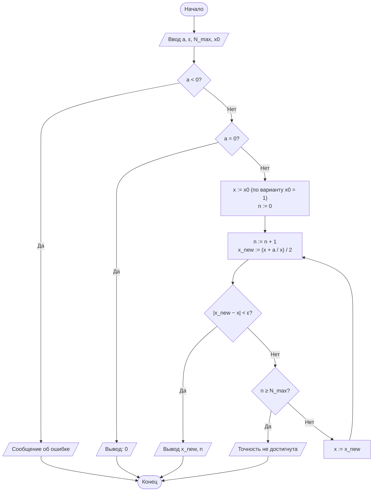
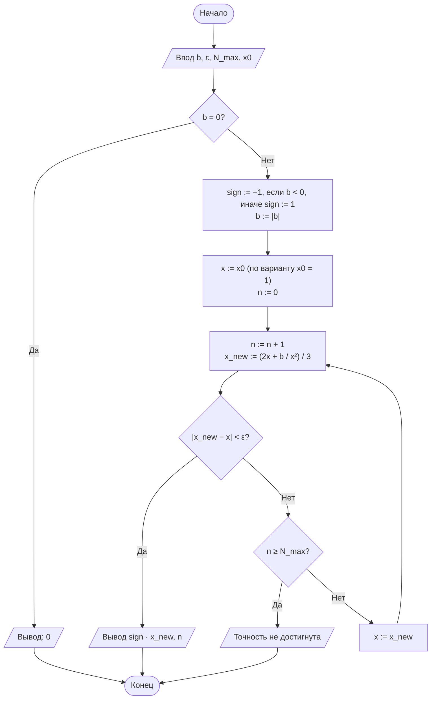
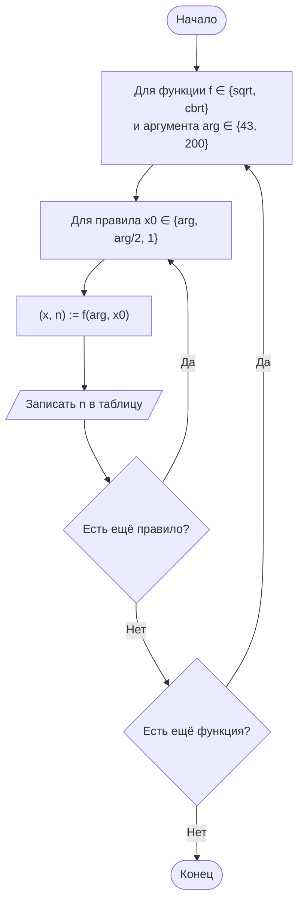

<div align="center">

**Дисциплина «Теория алгоритмов»**<br>
Направление подготовки 38.03.05 «Бизнес-информатика», 2 курс

# Отчёт по лабораторной работе № 1

### Итерационные методы вычисления элементарных функций: квадратный корень, кубический корень и натуральный логарифм

**Вариант 16**

Выполнил: студент группы ________ **Насруллаев И. Р.**<br>
Проверил: ________________

2026

</div>

---

## Содержание

1. [Цель и задачи работы](#1-цель-и-задачи-работы)
2. [Задание варианта](#2-задание-варианта)
3. [Краткие теоретические сведения](#3-краткие-теоретические-сведения)
4. [Блок-схемы алгоритмов](#4-блок-схемы-алгоритмов)
5. [Листинг программы](#5-листинг-программы)
6. [Результаты расчётов](#6-результаты-расчётов)
7. [Анализ результатов и выводы](#7-анализ-результатов-и-выводы)
8. [Ответы на контрольные вопросы](#8-ответы-на-контрольные-вопросы)

---

## 1. Цель и задачи работы

**Цель работы:** сформировать представление об итерационных алгоритмах как о классе вычислительных процедур, результат которых достигается последовательным уточнением приближений, и освоить приёмы оценки их сходимости и трудоёмкости.

**Задачи:**

1. Изучить понятия итерационного процесса, начального приближения, критерия остановки и скорости сходимости.
2. Реализовать алгоритмы вычисления $\sqrt{a}$ и $\sqrt[3]{b}$ методом Ньютона, а также $\ln c$ методом разложения в степенной ряд.
3. Экспериментально определить число итераций, необходимое для достижения заданной точности $\varepsilon$.
4. Сравнить полученные значения с эталонными значениями стандартной библиотеки (`math`) и оценить абсолютную погрешность.

## 2. Задание варианта

Вычислить $\sqrt{43}$, $\sqrt[3]{200}$ и $\ln \text{2,5}$ с точностью $\varepsilon = 10^{-8}$.

| $a$ для $\sqrt{a}$ | $b$ для $\sqrt[3]{b}$ | $c$ для $\ln c$ | $\varepsilon$ | Критерий остановки | $x_0$ | Доп. задание |
|---|---|---|---|---|---|---|
| 43 | 200 | 2,5 | $10^{-8}$ | Р — по разности соседних приближений | $x_0 = 1$ | Д2 |

**Дополнительное задание Д2.** Сравнить три способа выбора начального приближения ($x_0 = a$, $x_0 = a/2$, $x_0 = 1$) по числу итераций. Результаты оформить таблицей. Для кубического корня роль $a$ играет $b$.

Ограничение на число итераций: $N_{\max} = 100$ для методов Ньютона и $10\,000$ членов для ряда.

## 3. Краткие теоретические сведения

*Итерационный алгоритм* получает искомую величину $x^*$ как предел последовательности приближений, где каждое следующее приближение вычисляется по предыдущему: $x_{n+1} = \varphi(x_n)$. Алгоритм задаётся начальным приближением $x_0$, итерационной формулой $\varphi$ и критерием остановки. В работе используется критерий по разности соседних приближений $\lvert x_{n+1} - x_n \rvert < \varepsilon$, а страховкой от зацикливания служит предельное число итераций $N_{\max}$.

**Порядок сходимости.** Если $e_n = \lvert x_n - x^* \rvert$, то процесс сходится с порядком $p$, когда $e_{n+1} \approx C \cdot e_n^{\,p}$. При $p = 1$ число верных знаков растёт на постоянную величину за итерацию, при $p = 2$ — примерно удваивается.

**Метод Ньютона** для уравнения $F(x) = 0$:

$$x_{n+1} = x_n - \frac{F(x_n)}{F'(x_n)}.$$

- Квадратный корень, $F(x) = x^2 - a$ (формула Герона):

$$x_{n+1} = \frac{1}{2}\left(x_n + \frac{a}{x_n}\right).$$

- Кубический корень, $F(x) = x^3 - b$:

$$x_{n+1} = \frac{1}{3}\left(2x_n + \frac{b}{x_n^2}\right).$$

Для $b < 0$ используется тождество $\sqrt[3]{b} = -\sqrt[3]{\lvert b \rvert}$: метод применяется к модулю, знак восстанавливается в конце.

**Выбор начального приближения.** Для рассматриваемых функций метод сходится при любом $x_0 > 0$, но число итераций зависит от того, насколько далеко $x_0$ от корня. Пока $x_n \gg x^*$, формула Герона даёт $x_{n+1} \approx x_n / 2$, а формула для кубического корня — $x_{n+1} \approx \tfrac{2}{3} x_n$: на этом этапе сходимость лишь линейная.

**Натуральный логарифм** вычисляется по преобразованному ряду, который сходится при любом $c > 0$, так как $\lvert y \rvert < 1$:

$$\ln c = 2\left(y + \frac{y^3}{3} + \frac{y^5}{5} + \ldots\right), \qquad y = \frac{c-1}{c+1}.$$

Член ряда $t_k = \dfrac{2\,y^{2k+1}}{2k+1}$ получается из предыдущего умножением степени на $y^2$. Суммирование прекращается, когда $\lvert t_k \rvert < \varepsilon$. Для $c = \text{2,5}$ имеем $y = \text{1,5}/\text{3,5} = 3/7 \approx \text{0,4286}$, $y^2 \approx \text{0,184}$.

**Трудоёмкость:**

| Метод | Порядок сходимости | Оценка $N(\varepsilon)$ |
|---|---|---|
| Метод Ньютона (квадратный и кубический корни) | 2 | $O(\log\log(1/\varepsilon))$ |
| Ряд для $\ln$ (без нормализации) | 1 | $O\left(\log(1/\varepsilon) \,/\, \log(1/\lvert y \rvert)\right)$ |

## 4. Блок-схемы алгоритмов

### 4.1. Квадратный корень $\sqrt{a}$



### 4.2. Кубический корень $\sqrt[3]{b}$



### 4.3. Натуральный логарифм $\ln c$


### 4.4. Сравнение начальных приближений (Д2)



## 5. Листинг программы

Файл [`lr1.py`](lr1.py). Функции не используют `math.sqrt`, `math.log` и `**0.5`; модуль `math` нужен только для эталонных значений. Каждая функция возвращает пару «результат, число итераций». Начальное приближение передаётся параметром `x0` (по умолчанию $x_0 = 1$, как требует вариант), что позволяет выполнить задание Д2 без дублирования кода.

```python
"""
Лабораторная работа № 1. Вариант 16.
Итерационные методы вычисления √a, ∛b, ln c.
Доп. задание Д2: сравнение способов выбора x0 (a, a/2, 1).
"""
import math

EPS = 1e-8
N_MAX = 100

# способы выбора начального приближения (Д2)
X0_RULES = {
    "x0 = a": lambda a: a,
    "x0 = a/2": lambda a: a / 2,
    "x0 = 1": lambda a: 1.0,
}


def sqrt_newton(a, eps=EPS, n_max=N_MAX, x0=1.0):
    """Квадратный корень методом Ньютона (формула Герона)."""
    if a < 0:
        raise ValueError("Подкоренное выражение должно быть неотрицательным")
    if a == 0:
        return 0.0, 0
    x = x0
    for n in range(1, n_max + 1):
        x_new = 0.5 * (x + a / x)
        if abs(x_new - x) < eps:
            return x_new, n
        x = x_new
    raise RuntimeError("Точность не достигнута за N_MAX итераций")


def cbrt_newton(b, eps=EPS, n_max=N_MAX, x0=1.0):
    """Кубический корень методом Ньютона (с учётом знака)."""
    if b == 0:
        return 0.0, 0
    sign = -1 if b < 0 else 1
    b = abs(b)
    x = x0
    for n in range(1, n_max + 1):
        x_new = (2 * x + b / (x * x)) / 3
        if abs(x_new - x) < eps:
            return sign * x_new, n
        x = x_new
    raise RuntimeError("Точность не достигнута за N_MAX итераций")


def ln_series(c, eps=EPS, n_max=10_000):
    """Натуральный логарифм через ряд ln((1+y)/(1-y)), y=(c-1)/(c+1)."""
    if c <= 0:
        raise ValueError("Аргумент логарифма должен быть положительным")
    y = (c - 1) / (c + 1)
    y2 = y * y
    power = y          # текущая степень y^(2k+1)
    total = 0.0
    for k in range(n_max):
        term = 2 * power / (2 * k + 1)
        if abs(term) < eps:
            return total, k
        total += term
        power *= y2
    raise RuntimeError("Точность не достигнута за n_max итераций")


def trace(step, x0, arg, ref, eps=EPS, n_max=N_MAX):
    """Печатает ход итераций метода Ньютона: n, x_n, |x_n − x_(n−1)|, |x_n − x*|."""
    x = x0
    print(f"{'n':>3}{'x_n':>24}{'|x_n - x_(n-1)|':>18}{'|x_n - x*|':>14}")
    print(f"{0:>3}{x:>24.15f}{'':>18}{abs(x - ref):>14.2e}")
    for n in range(1, n_max + 1):
        x_new = step(x, arg)
        print(f"{n:>3}{x_new:>24.15f}{abs(x_new - x):>18.2e}"
              f"{abs(x_new - ref):>14.2e}")
        if abs(x_new - x) < eps:
            return
        x = x_new


if __name__ == "__main__":
    a, b, c = 43, 200, 2.5

    print(f"Вариант 16: a = {a}, b = {b}, c = {c}, eps = {EPS:.0e}, x0 = 1\n")
    print(f"{'Функция':<10}{'Аргумент':>10}{'Результат':>20}"
          f"{'Эталон':>20}{'Погрешность':>14}{'Итераций':>10}")
    for name, f, arg, ref in [("sqrt", sqrt_newton, a, math.sqrt(a)),
                              ("cbrt", cbrt_newton, b, b ** (1 / 3)),
                              ("ln", ln_series, c, math.log(c))]:
        val, n = f(arg)
        print(f"{name:<10}{arg:>10}{val:>20.14f}{ref:>20.14f}"
              f"{abs(val - ref):>14.2e}{n:>10}")

    # Д2: число итераций при разных x0
    print("\nД2. Число итераций при разных начальных приближениях")
    print(f"{'Функция':<10}" + "".join(f"{rule:>12}" for rule in X0_RULES))
    for name, f, arg in [("sqrt", sqrt_newton, a), ("cbrt", cbrt_newton, b)]:
        row = f"{name:<10}"
        for rule in X0_RULES.values():
            row += f"{f(arg, x0=rule(arg))[1]:>12}"
        print(row)

    print("\nПогрешность |x - x*| при разных x0")
    for name, f, arg, ref in [("sqrt", sqrt_newton, a, math.sqrt(a)),
                              ("cbrt", cbrt_newton, b, b ** (1 / 3))]:
        row = f"{name:<10}"
        for rule in X0_RULES.values():
            row += f"{abs(f(arg, x0=rule(arg))[0] - ref):>12.2e}"
        print(row)

    print(f"\nХод итераций для sqrt({a}), x0 = 1")
    trace(lambda x, s: 0.5 * (x + s / x), 1.0, a, math.sqrt(a))
    print(f"\nХод итераций для cbrt({b}), x0 = 1")
    trace(lambda x, s: (2 * x + s / (x * x)) / 3, 1.0, b, b ** (1 / 3))
```

Запуск:

```bash
python lr1.py
```

Вывод программы сохранён в файле [`results.txt`](results.txt).

## 6. Результаты расчётов

### 6.1. Основное задание

**Таблица 1. Результаты вычислений (вариант 16, $\varepsilon = 10^{-8}$, $x_0 = 1$)**

| Функция | Аргумент | Результат | Эталон (`math`) | Абс. погрешность | Число итераций |
|---|---|---|---|---|---|
| $\sqrt{a}$ | 43 | 6,55743852430200 | 6,55743852430200 | $0$ (в пределах `float`) | 8 |
| $\sqrt[3]{b}$ | 200 | 5,84803547642573 | 5,84803547642573 | $\text{8,88} \cdot 10^{-16}$ | 12 |
| $\ln c$ | 2,5 | 0,91629072973052 | 0,91629073187416 | $\text{2,14} \cdot 10^{-9}$ | 10 |

Эталон для кубического корня вычислен как `b ** (1/3)`. Он сам содержит ошибку округления в последнем двоичном разряде, поэтому разница $\text{8,88} \cdot 10^{-16}$ — это уровень машинной точности, а не погрешность метода.

**Таблица 2. Ход итераций при вычислении $\sqrt{43}$ ($x_0 = 1$)**

| $n$ | $x_n$ | $\lvert x_n - x_{n-1} \rvert$ | Погрешность $\lvert x_n - \sqrt{43} \rvert$ |
|---|---|---|---|
| 0 | 1,000000000000000 | — | $\text{5,56}$ |
| 1 | 22,000000000000000 | $\text{2,10} \cdot 10^{1}$ | $\text{1,54} \cdot 10^{1}$ |
| 2 | 11,977272727272727 | $\text{1,00} \cdot 10^{1}$ | $\text{5,42}$ |
| 3 | 7,783702777298602 | $\text{4,19}$ | $\text{1,23}$ |
| 4 | 6,654032912679918 | $\text{1,13}$ | $\text{9,66} \cdot 10^{-2}$ |
| 5 | 6,558139638647883 | $\text{9,59} \cdot 10^{-2}$ | $\text{7,01} \cdot 10^{-4}$ |
| 6 | 6,557438561779193 | $\text{7,01} \cdot 10^{-4}$ | $\text{3,75} \cdot 10^{-8}$ |
| 7 | 6,557438524302000 | $\text{3,75} \cdot 10^{-8}$ | $0$ |
| 8 | 6,557438524302000 | $0$ | $0$ |

На 7-м шаге погрешность уже равна нулю, но разность $\text{3,75} \cdot 10^{-8}$ ещё больше $\varepsilon = 10^{-8}$. Критерий выполняется только на 8-м шаге.

**Таблица 3. Ход итераций при вычислении $\sqrt[3]{200}$ ($x_0 = 1$)**

| $n$ | $x_n$ | $\lvert x_n - x_{n-1} \rvert$ | Погрешность $\lvert x_n - \sqrt[3]{200} \rvert$ |
|---|---|---|---|
| 0 | 1,000000000000000 | — | $\text{4,85}$ |
| 1 | 67,333333333333329 | $\text{6,63} \cdot 10^{1}$ | $\text{6,15} \cdot 10^{1}$ |
| 2 | 44,903593329629992 | $\text{2,24} \cdot 10^{1}$ | $\text{3,91} \cdot 10^{1}$ |
| 3 | 29,968792213155670 | $\text{1,49} \cdot 10^{1}$ | $\text{2,41} \cdot 10^{1}$ |
| 4 | 20,053423236181668 | $\text{9,92}$ | $\text{1,42} \cdot 10^{1}$ |
| 5 | 13,534728658407063 | $\text{6,52}$ | $\text{7,69}$ |
| 6 | 9,387075547801500 | $\text{4,15}$ | $\text{3,54}$ |
| 7 | 7,014618620260401 | $\text{2,37}$ | $\text{1,17}$ |
| 8 | 6,031291731791026 | $\text{9,83} \cdot 10^{-1}$ | $\text{1,83} \cdot 10^{-1}$ |
| 9 | 5,853547185474373 | $\text{1,78} \cdot 10^{-1}$ | $\text{5,51} \cdot 10^{-3}$ |
| 10 | 5,848040664630545 | $\text{5,51} \cdot 10^{-3}$ | $\text{5,19} \cdot 10^{-6}$ |
| 11 | 5,848035476430335 | $\text{5,19} \cdot 10^{-6}$ | $\text{4,60} \cdot 10^{-12}$ |
| 12 | 5,848035476425732 | $\text{4,60} \cdot 10^{-12}$ | $\text{8,88} \cdot 10^{-16}$ |

**Таблица 4. Члены ряда при вычислении $\ln \text{2,5}$ ($y = 3/7$)**

| $k$ | $t_k$ | $k$ | $t_k$ |
|---|---|---|---|
| 0 | $\text{8,57} \cdot 10^{-1}$ | 6 | $\text{2,53} \cdot 10^{-6}$ |
| 1 | $\text{5,25} \cdot 10^{-2}$ | 7 | $\text{4,03} \cdot 10^{-7}$ |
| 2 | $\text{5,78} \cdot 10^{-3}$ | 8 | $\text{6,53} \cdot 10^{-8}$ |
| 3 | $\text{7,59} \cdot 10^{-4}$ | 9 | $\text{1,07} \cdot 10^{-8}$ |
| 4 | $\text{1,08} \cdot 10^{-4}$ | 10 | $\text{1,78} \cdot 10^{-9} < \varepsilon$ |
| 5 | $\text{1,63} \cdot 10^{-5}$ | | |

Каждый следующий член примерно в 6–7 раз меньше предыдущего ($1/y^2 \approx \text{5,4}$, плюс множитель $(2k-1)/(2k+1)$). Член $t_{10}$ меньше $\varepsilon$, поэтому суммируются члены $t_0, \ldots, t_9$ — 10 членов ряда.

### 6.2. Дополнительное задание Д2 — выбор начального приближения

**Таблица 5. Число итераций при разных $x_0$ ($\varepsilon = 10^{-8}$)**

| Функция | $x_0 = a$ | $x_0 = a/2$ | $x_0 = 1$ |
|---|---|---|---|
| $\sqrt{43}$ | 8 ($x_0 = 43$) | **7** ($x_0 = \text{21,5}$) | 8 |
| $\sqrt[3]{200}$ | 14 ($x_0 = 200$) | **12** ($x_0 = 100$) | **12** |

Во всех шести случаях итоговая погрешность одинакова: $0$ для $\sqrt{43}$ и $\text{8,88} \cdot 10^{-16}$ для $\sqrt[3]{200}$. Выбор $x_0$ влияет только на число итераций, но не на точность.

**Таблица 6. Первое приближение $x_1$ при разных $x_0$**

| Функция | $x_0 = a$ | $x_0 = a/2$ | $x_0 = 1$ |
|---|---|---|---|
| $\sqrt{43}$ ($x^* \approx \text{6,557}$) | 22,000 | 11,750 | 22,000 |
| $\sqrt[3]{200}$ ($x^* \approx \text{5,848}$) | 133,335 | 66,673 | 67,333 |

## 7. Анализ результатов и выводы

1. Все три алгоритма достигли заданной точности $\varepsilon = 10^{-8}$. Фактическая погрешность методов Ньютона оказалась на уровне машинной точности ($0$ и $\text{8,88} \cdot 10^{-16}$), то есть на 7–8 порядков меньше $\varepsilon$. Причина — квадратичная сходимость: по табл. 3 погрешность меняется как $\text{1,8} \cdot 10^{-1} \to \text{5,5} \cdot 10^{-3} \to \text{5,2} \cdot 10^{-6} \to \text{4,6} \cdot 10^{-12}$, число верных знаков примерно удваивается на каждом шаге. К моменту выполнения критерия по разности погрешность уже пренебрежимо мала.
2. При $x_0 = 1$ оба метода Ньютона на первом шаге «перелетают» далеко за корень: $x_1 = 22$ для $\sqrt{43}$ и $x_1 \approx \text{67,3}$ для $\sqrt[3]{200}$. Это следует из формул: при малом $x_0$ слагаемое $a/x_0$ (или $b/x_0^2$) очень велико. Далее приближения монотонно убывают, но поначалу медленно — примерно вдвое за шаг для квадратного корня и в 1,5 раза для кубического (табл. 2, 3). Поэтому для $\sqrt[3]{200}$ понадобилось 12 итераций, из которых 7 ушли на линейный «спуск» к окрестности корня, и лишь последние 4–5 работали в квадратичном режиме.
3. Ряд для $\ln \text{2,5}$ ($\lvert y \rvert = 3/7$) сходится линейно: понадобилось 10 членов, а погрешность $\text{2,14} \cdot 10^{-9}$ того же порядка, что и последний отброшенный член ($\text{1,78} \cdot 10^{-9}$). Это характерно для процессов первого порядка. Аргумент $c = \text{2,5}$ близок к 1, поэтому ряд сходится быстро. Для больших аргументов без нормализации картина хуже: та же функция при $\varepsilon = 10^{-8}$ для $c = 100$ требует 317 членов (погрешность $\text{2,3} \cdot 10^{-7}$), для $c = 1000$ — 2636 членов (погрешность $\text{2,3} \cdot 10^{-6}$), и погрешность уже **больше** $\varepsilon$.
4. **Дополнительное задание Д2.** Лучшим для обоих корней оказался выбор $x_0 = a/2$ (7 и 12 итераций), худшим — $x_0 = a$ для кубического корня (14 итераций).
   - Для квадратного корня $x_0 = a$ и $x_0 = 1$ дали **одинаковое** число итераций (8). Это не совпадение: формула Герона симметрична относительно замены $x \leftrightarrow a/x$, поэтому $x_0 = 1$ и $x_0 = a$ дают одно и то же $x_1 = (1 + a)/2 = 22$, и дальше последовательности совпадают. Выбор $x_0 = \text{21,5}$ даёт $x_1 = \text{11,75}$ — это ровно на один шаг ближе к корню.
   - Для кубического корня $x_0 = 1$ и $x_0 = b/2 = 100$ дают почти одинаковое $x_1$ (67,3 и 66,7), поэтому и одинаковое число итераций (12). При $x_0 = b = 200$ спуск начинается со 133 и требует на 2 шага больше: чтобы уменьшиться в 2 раза при множителе $2/3$, нужно $\log_{1{,}5} 2 \approx \text{1,7}$ шага.
   - Общий вывод: для метода Ньютона важно, чтобы $x_0$ было по порядку величины близко к корню. Простые правила $x_0 = a$, $a/2$, $1$ дают разницу лишь в 1–2 итерации, так как квадратичная сходимость быстро «прощает» плохой старт. Существенно сэкономить можно, если оценить порядок корня заранее, например, по числу цифр аргумента ($x_0 = 10^{\lfloor d/2 \rfloor}$, где $d$ — число цифр $a$): для $a = 43$ это $x_0 = 10$ и всего 5 итераций.

## 8. Ответы на контрольные вопросы

**1. Определение итерационного алгоритма и его свойства.** Итерационный алгоритм получает результат как предел последовательности приближений $x_{n+1} = \varphi(x_n)$. *Дискретность* — вычисление разбито на отдельные шаги-итерации. *Детерминированность* — при одних и тех же $x_0$ и входных данных получается одна и та же последовательность. *Массовость* — алгоритм применим к любому аргументу из области определения, а не к одному числу. *Результативность* сама по себе не гарантирована (предел достигается только за бесконечное число шагов), поэтому её обеспечивают критерий остановки по точности и ограничение $N_{\max}$.

**2. Вывод формулы Герона.** Для $F(x) = x^2 - a$ имеем $F'(x) = 2x$:

$$x_{n+1} = x_n - \frac{x_n^2 - a}{2x_n} = \frac{2x_n^2 - x_n^2 + a}{2x_n} = \frac{x_n^2 + a}{2x_n} = \frac{1}{2}\left(x_n + \frac{a}{x_n}\right).$$

**3. Критерии «по разности» и «по невязке».** Критерий по разности $\lvert x_{n+1} - x_n \rvert < \varepsilon$ оценивает, насколько изменилось приближение. Критерий по невязке $\lvert F(x_n) \rvert < \varepsilon$ оценивает, насколько точно выполняется уравнение. Они расходятся, когда значения функции и аргумента имеют разный масштаб. Для $\sqrt{43}$ невязка $\lvert x^2 - 43 \rvert \approx 2\sqrt{43} \cdot \lvert x - x^* \rvert \approx 13 \lvert x - x^* \rvert$, то есть критерий по невязке строже примерно в 13 раз. Для $\sqrt[3]{200}$ множитель ещё больше: $3x^{*2} \approx 103$. При очень малом аргументе (например, $a = 10^{-8}$) наоборот: условие $\lvert x^2 - a \rvert < \varepsilon$ выполняется даже при грубом $x$.

**4. Порядок сходимости.** Это показатель $p$ в соотношении $e_{n+1} \approx C \cdot e_n^{\,p}$. Метод половинного деления на каждом шаге лишь вдвое сужает отрезок ($p = 1$, один двоичный знак за итерацию; для $\varepsilon = 10^{-8}$ на отрезке длины 43 нужно 33 шага). У метода Ньютона $p = 2$: из разложения Тейлора $e_{n+1} \approx \dfrac{F''}{2F'} e_n^2$, поэтому вблизи корня число верных знаков удваивается (табл. 2, 3).

**5. Влияние начального приближения.** Чем дальше $x_0$ от корня, тем дольше длится начальный «линейный» этап. В расчётах (табл. 5): $\sqrt[3]{200}$ при $x_0 = 100$ — 12 итераций, а при $x_0 = 200$ — 14, так как из 200 спуск к корню $\approx \text{5,85}$ при множителе $\approx 2/3$ длится на 2 шага дольше. Для $\sqrt{43}$ лучшим оказалось $x_0 = \text{21,5}$ (7 итераций против 8).

**6. Почему ряд $\ln(1+x)$ не подходит для $\ln 100$.** Ряд сходится только при $-1 < x \le 1$, а для $\ln 100$ нужно $x = 99$: члены ряда $99;\ -\text{4900,5};\ 323\,433;\ \ldots$ неограниченно растут, ряд расходится. Для преобразованного ряда $y = 99/101 \approx \text{0,98}$, $\lvert y \rvert < 1$ — ряд сходится, хотя и медленно (317 членов при $\varepsilon = 10^{-8}$). Даже для аргумента варианта $c = \text{2,5}$ ряд $\ln(1 + x)$ с $x = \text{1,5}$ расходится, а преобразованный сходится за 10 членов.

**7. Смысл нормализации $c = m \cdot 2^k$.** При $m \in [\text{0,5};\ 1)$ значение $y = \dfrac{m-1}{m+1}$ лежит в $[-1/3;\ 0)$, то есть $y^2 \le 1/9$, и каждый следующий член ряда меньше предыдущего минимум в 9 раз. Для $\ln 2$ также $y = 1/3$. Логарифм собирается как $\ln c = \ln m + k \ln 2$. Например, $\text{2,5} = \text{0,625} \cdot 2^2$, и для $m = \text{0,625}$ получается $\lvert y \rvert \approx \text{0,23}$ вместо 0,43.

**8. Почему погрешность может быть меньше или больше $\varepsilon$.** У метода Ньютона погрешность после шага порядка квадрата предыдущей разности, поэтому при остановке она много меньше $\varepsilon$ (разность $\text{4,6} \cdot 10^{-12}$ → погрешность $\text{8,9} \cdot 10^{-16}$, табл. 3). Больше $\varepsilon$ она может оказаться у медленно сходящихся процессов: малый последний член не гарантирует малой суммы всех отброшенных членов. Остаток ряда для $\ln$ примерно равен $t_k / (1 - y^2)$. Для $c = \text{2,5}$ это $\approx \text{1,2} \cdot t_k$, и погрешность $\text{2,1} \cdot 10^{-9}$ осталась меньше $\varepsilon$. Но при $y \to 1$ множитель достигает сотен: для $c = 1000$ погрешность $\text{2,3} \cdot 10^{-6} \gg \varepsilon$.

**9. Зачем нужно ограничение $N_{\max}$.** Оно гарантирует завершение алгоритма (результативность), если процесс расходится, зацикливается или точность недостижима. Например, $\varepsilon$ меньше машинной точности чисел `float` (≈ $10^{-16}$ относительно величины числа) может никогда не выполниться из-за ошибок округления. Без ограничения программа зависнет, а с ним выдаст понятное сообщение.

**10. Пример из экономики — расчёт IRR.** Внутренняя норма доходности инвестиционного проекта — это ставка $r$, при которой чистая приведённая стоимость равна нулю:

$$NPV(r) = \sum_{t=0}^{T} \frac{CF_t}{(1 + r)^t} = 0.$$

Аналитически это уравнение степени $T$ не решается, поэтому $r$ находят итерационно — методом Ньютона $r_{n+1} = r_n - NPV(r_n) / NPV'(r_n)$ или методом половинного деления, останавливаясь, когда $\lvert r_{n+1} - r_n \rvert < \varepsilon$. Так работает функция ВСД (IRR) в Excel. Как и в задании Д2, от начального приближения (параметр «предположение», по умолчанию 10 %) зависит число итераций, а иногда и то, к какому из корней сойдётся процесс.

---

**Литература**

1. Кнут Д. Э. Искусство программирования. Т. 1. Основные алгоритмы. — 3-е изд. — М.: Вильямс, 2017.
2. Вирт Н. Алгоритмы и структуры данных. Новая версия для Оберона. — М.: ДМК Пресс, 2016.
3. Вержбицкий В. М. Основы численных методов. — М.: Высшая школа, 2009.
4. Бахвалов Н. С., Жидков Н. П., Кобельков Г. М. Численные методы. — 9-е изд. — М.: Лаборатория знаний, 2020.
5. ГОСТ 19.701-90 (ИСО 5807-85). ЕСПД. Схемы алгоритмов, программ, данных и систем.
