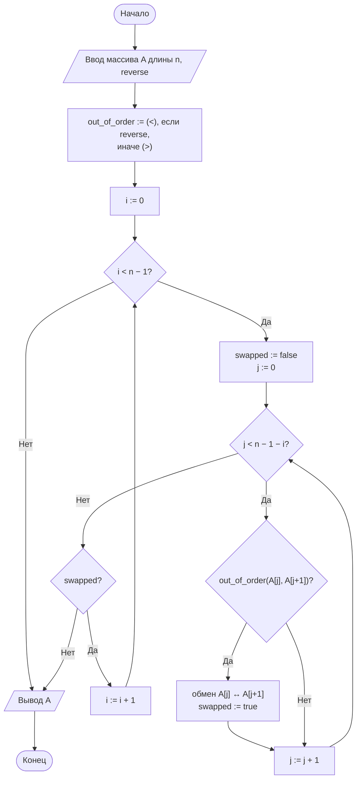
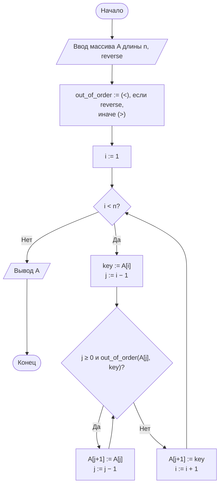

<div align="center">

**Дисциплина «Теория алгоритмов»**<br>
Направление подготовки 38.03.05 «Бизнес-информатика», 2 курс

# Отчёт по лабораторной работе № 2

### Эмпирический анализ временной сложности алгоритмов сортировки. Часть 1: квадратичные алгоритмы (сортировка обменом и сортировка вставками)

**Вариант 16**

Выполнил: студент группы ________ **Насруллаев И. Р.**<br>
Проверил: ________________

2026

</div>

---

## Содержание

1. [Цель и задачи работы](#1-цель-и-задачи-работы)
2. [Задание варианта](#2-задание-варианта)
3. [Описание алгоритмов и теоретические оценки](#3-описание-алгоритмов-и-теоретические-оценки)
4. [Блок-схемы алгоритмов](#4-блок-схемы-алгоритмов)
5. [Листинг программы](#5-листинг-программы)
6. [Условия эксперимента](#6-условия-эксперимента)
7. [Результаты измерений](#7-результаты-измерений)
8. [Выводы](#8-выводы)
9. [Ответы на контрольные вопросы](#9-ответы-на-контрольные-вопросы)

---

## 1. Цель и задачи работы

**Цель работы:** освоить методику экспериментального исследования временной сложности алгоритмов и сопоставить полученные эмпирические зависимости с теоретическими асимптотическими оценками на примере простых алгоритмов сортировки.

**Задачи:**

1. Изучить понятия вычислительной сложности, асимптотических обозначений $O$, $\Omega$, $\Theta$, а также лучшего, среднего и худшего случаев.
2. Реализовать сортировку обменом («пузырьком») и сортировку вставками.
3. Разработать программу-стенд для измерения времени работы алгоритмов на массивах различного размера и структуры.
4. Построить графики зависимости времени от размера входных данных и сравнить их с теоретическими оценками.
5. Сформулировать выводы о применимости алгоритмов.

## 2. Задание варианта

Сравнить время работы сортировки пузырьком (с флагом) и сортировки вставками на случайных целочисленных массивах.

| Размеры массива $n$ | Тип данных | Диапазон значений | Повторов $k$ | Доп. задание |
|---|---|---|---|---|
| 500, 1500, 2500, 3500, 4500 | R (случайные) | [0; 1 000 000] | 3 | М3 |

Каждое измерение повторяется 3 раза, результатом считается медиана.

**Дополнительное задание М3.** Реализовать сортировку **по убыванию**. Для этого передавать в функцию параметр `reverse` или функцию-компаратор.

## 3. Описание алгоритмов и теоретические оценки

Для квадратичного алгоритма $T(n) = \Theta(n^2)$, поэтому **при увеличении $n$ в $m$ раз время работы должно возрастать примерно в $m^2$ раз**, а отношение $T(n)/n^2$ должно оставаться приблизительно постоянным. Размеры варианта не образуют пар «$n$ и $2n$», поэтому рост проверяется по соседним размерам: теоретическое отношение $T(n_2)/T(n_1) = (n_2/n_1)^2$.

**Сортировка обменом (пузырьком).** Массив многократно просматривается слева направо, соседние элементы при нарушении порядка меняются местами. После $i$-го прохода $i$ «крайних» элементов стоят на своих местах в конце массива. Флаг `swapped` позволяет завершить работу досрочно, если за проход не было ни одного обмена. На упорядоченном массиве достаточно одного прохода.

**Сортировка вставками.** Массив делится на отсортированную (левую) и неотсортированную (правую) части. Очередной элемент-ключ вставляется на своё место в отсортированной части, а элементы, которые должны стоять после него, сдвигаются вправо. Число сдвигов равно числу **инверсий** — пар $(i, j)$, где $i < j$ и $A[i]$ должен стоять после $A[j]$.

**Сортировка по убыванию (М3).** Оба алгоритма сравнивают элементы в одном месте — в условии «пара стоит не по порядку». Поэтому направление сортировки задаётся одним параметром `reverse`: функция выбирает компаратор `out_of_order` — `operator.gt` ($a > b$) для возрастания или `operator.lt` ($a < b$) для убывания. Остальной код не меняется. Сравнение строгое в обоих направлениях, поэтому равные элементы не переставляются и **устойчивость сохраняется**. Трудоёмкость не меняется: на случайных данных число инверсий относительно убывающего порядка в среднем тоже $\approx n^2/4$. Но меняются лучший и худший случаи: для сортировки по убыванию лучший вход — массив, уже упорядоченный по убыванию, а худший — по возрастанию.

**Таблица 1. Теоретические оценки**

| Алгоритм | Лучший случай | Средний случай | Худший случай | Доп. память | Устойчивость |
|---|---|---|---|---|---|
| Пузырьком (с флагом) | $\Theta(n)$ | $\Theta(n^2)$ | $\Theta(n^2)$ | $O(1)$ | Да |
| Вставками | $\Theta(n)$ | $\Theta(n^2)$ | $\Theta(n^2)$ | $O(1)$ | Да |

На случайных данных сортировка вставками выполняет в среднем примерно вдвое меньше сравнений ($\approx n^2/4$ против $\approx n^2/2$), а сдвиг элемента дешевле обмена. Поэтому на практике она быстрее.

## 4. Блок-схемы алгоритмов

### 4.1. Сортировка пузырьком (с параметром reverse)



### 4.2. Сортировка вставками (с параметром reverse)



### 4.3. Экспериментальный стенд


## 5. Листинг программы

Вспомогательный модуль [`sorts_common.py`](sorts_common.py) (используется также в ЛР № 3). Функция `measure` получила параметр `reverse`: при сортировке по убыванию результат сверяется с `sorted(data, reverse=True)`.

```python
"""Общие функции для генерации данных и замера времени."""
import random
import statistics
import time


def generate_data(n, kind="random", lo=0, hi=100_000, seed=42):
    """Генерирует массив длины n заданного типа."""
    if kind == "duplicates":                 # тип D: много повторов
        lo, hi = 0, 10
    rng = random.Random(seed + n)      # воспроизводимость эксперимента
    data = [rng.randint(lo, hi) for _ in range(n)]
    if kind == "sorted":
        data.sort()
    elif kind == "reversed":
        data.sort(reverse=True)
    elif kind == "nearly_sorted":
        data.sort()
        for _ in range(max(1, n // 20)):          # 5 % случайных перестановок
            i, j = rng.randrange(n), rng.randrange(n)
            data[i], data[j] = data[j], data[i]
    return data


def measure(sort_func, data, repeats=3, reverse=False):
    """Возвращает медианное время работы sort_func на данных data, с.

    При reverse=True функция вызывается как sort_func(data, reverse=True),
    а результат сверяется с sorted(data, reverse=True)."""
    times = []
    expected = sorted(data, reverse=reverse)
    for _ in range(repeats):
        start = time.perf_counter()
        result = sort_func(data, reverse=True) if reverse else sort_func(data)
        times.append(time.perf_counter() - start)
        assert result == expected, f"{sort_func.__name__}: ошибка сортировки"
    return statistics.median(times)
```

Основной модуль [`lr2.py`](lr2.py). Функции сортировки не изменяют исходный массив, а возвращают новый отсортированный список.

```python
"""
Лабораторная работа № 2. Вариант 16.
Сравнение сортировки пузырьком и сортировки вставками.
Доп. задание М3: сортировка по убыванию через параметр reverse.
"""
import operator

from sorts_common import generate_data, measure

LO, HI = 0, 1_000_000             # диапазон значений варианта


def bubble_sort(arr, reverse=False):
    """Сортировка пузырьком с флагом досрочного выхода.

    reverse=False — по возрастанию, reverse=True — по убыванию."""
    out_of_order = operator.lt if reverse else operator.gt
    a = arr.copy()
    n = len(a)
    for i in range(n - 1):
        swapped = False
        for j in range(n - 1 - i):
            if out_of_order(a[j], a[j + 1]):
                a[j], a[j + 1] = a[j + 1], a[j]
                swapped = True
        if not swapped:
            break
    return a


def insertion_sort(arr, reverse=False):
    """Сортировка вставками.

    reverse=False — по возрастанию, reverse=True — по убыванию."""
    out_of_order = operator.lt if reverse else operator.gt
    a = arr.copy()
    for i in range(1, len(a)):
        key = a[i]
        j = i - 1
        while j >= 0 and out_of_order(a[j], key):
            a[j + 1] = a[j]
            j -= 1
        a[j + 1] = key
    return a


if __name__ == "__main__":
    import matplotlib.pyplot as plt

    SIZES = [500, 1500, 2500, 3500, 4500]
    REPEATS = 3
    algorithms = {"Пузырьком": bubble_sort, "Вставками": insertion_sort}
    colors = {"Пузырьком": "#2a78d6", "Вставками": "#eb6834"}

    # М3: демонстрация на коротком массиве
    demo = generate_data(10, lo=LO, hi=HI)
    print("Исходный массив:     ", demo)
    for name, func in algorithms.items():
        print(f"{name:<10} возр.:  ", func(demo))
        print(f"{name:<10} убыв.:  ", func(demo, reverse=True))
    print()

    results = {(name, rev): [] for name in algorithms for rev in (False, True)}
    print(f"{'n':>6}" + "".join(f"{name + ' ↑':>14}{name + ' ↓':>14}"
                                for name in algorithms) + f"{'Пуз./Вст.':>12}")
    for n in SIZES:
        data = generate_data(n, kind="random", lo=LO, hi=HI)
        row = f"{n:>6}"
        for name, func in algorithms.items():
            for rev in (False, True):
                t = measure(func, data, REPEATS, reverse=rev)
                results[name, rev].append(t)
                row += f"{t:>14.4f}"
        row += (f"{results['Пузырьком', False][-1]
                   / results['Вставками', False][-1]:>12.2f}")
        print(row)

    # Проверка квадратичного роста: T(n2)/T(n1) против (n2/n1)²
    print("\nОтношение T(n2)/T(n1) (по возрастанию), теория для Θ(n²): (n2/n1)²")
    for n1, n2 in zip(SIZES, SIZES[1:]):
        i, j = SIZES.index(n1), SIZES.index(n2)
        print(f"{n1:>6} -> {n2:<6}" + "".join(
            f"{results[name, False][j] / results[name, False][i]:>14.2f}"
            for name in algorithms) + f"{(n2 / n1) ** 2:>14.2f}")

    print("\nОтношение T(n)/n² · 10⁸ (должно быть примерно постоянным)")
    for k, n in enumerate(SIZES):
        print(f"{n:>6}" + "".join(
            f"{results[name, rev][k] / n ** 2 * 1e8:>14.2f}"
            for name in algorithms for rev in (False, True)))

    print("\nМ3. Отношение T(убыв.)/T(возр.)")
    for k, n in enumerate(SIZES):
        print(f"{n:>6}" + "".join(
            f"{results[name, True][k] / results[name, False][k]:>14.2f}"
            for name in algorithms))

    fig, ax = plt.subplots(figsize=(8, 5))
    for (name, rev), times in results.items():
        ax.plot(SIZES, times, marker="o", markersize=6, linewidth=2,
                color=colors[name], linestyle="--" if rev else "-",
                label=f"{name}, по {'убыванию' if rev else 'возрастанию'}")
    for name in algorithms:
        t = results[name, False][-1]
        ax.annotate(f"{t:.3f} с", (SIZES[-1], t),
                    textcoords="offset points", xytext=(-8, 8),
                    ha="right", fontsize=9, color="#333333")
    ax.set_xlabel("Размер массива n")
    ax.set_ylabel("Время, с")
    ax.set_title("Зависимость времени сортировки от n (случайные данные)")
    ax.set_xticks(SIZES)
    ax.grid(True, color="#e5e5e5", linewidth=0.8)
    ax.set_axisbelow(True)
    for side in ("top", "right"):
        ax.spines[side].set_visible(False)
    ax.legend(frameon=False)
    fig.tight_layout()
    fig.savefig("lr2_plot.png", dpi=150)
    plt.show()
```

Запуск (нужна библиотека `matplotlib`):

```bash
python lr2.py
```

Вывод программы сохранён в файле [`results.txt`](results.txt).

## 6. Условия эксперимента

| Параметр | Значение |
|---|---|
| Процессор | Intel Xeon @ 2,10 ГГц (виртуальная машина KVM, 4 vCPU) |
| Оперативная память | 16 ГБ |
| Операционная система | Linux, ядро 6.18, 64-бит |
| Интерпретатор | Python 3.13 (64-бит) |
| Таймер | `time.perf_counter()` |
| Генерация данных | `random.Random(42 + n)`, диапазон [0; 1 000 000], все алгоритмы получают копию одного и того же массива |
| Привязка к ядру | процесс запускался командой `taskset -c 3`, чтобы планировщик ОС не переносил его между ядрами |

Абсолютные значения времени на другой системе будут отличаться, но соотношения между ними должны сохраниться. Виртуальная машина делит физический процессор с другими задачами, поэтому разброс отдельных замеров достигает 10–20 %.

## 7. Результаты измерений

### 7.1. Демонстрация сортировки по убыванию (М3)

Массив из 10 элементов, сгенерированный той же функцией `generate_data`:

```
Исходный массив:      [281350, 57171, 922779, 760911, 537486, 507365, 896664, 987468, 389044, 426617]
Пузырьком  возр.:     [57171, 281350, 389044, 426617, 507365, 537486, 760911, 896664, 922779, 987468]
Пузырьком  убыв.:     [987468, 922779, 896664, 760911, 537486, 507365, 426617, 389044, 281350, 57171]
Вставками  возр.:     [57171, 281350, 389044, 426617, 507365, 537486, 760911, 896664, 922779, 987468]
Вставками  убыв.:     [987468, 922779, 896664, 760911, 537486, 507365, 426617, 389044, 281350, 57171]
```

Кроме того, при каждом замере результат сверяется с `sorted(data, reverse=True)` (оператор `assert` в функции `measure`), то есть корректность проверена на всех массивах эксперимента.

### 7.2. Время сортировки

**Таблица 2. Медианное время сортировки случайных массивов, с (↑ — по возрастанию, ↓ — по убыванию)**

| $n$ | Пузырьком ↑ | Пузырьком ↓ | Вставками ↑ | Вставками ↓ | Пузырёк / вставки (↑) |
|---|---|---|---|---|---|
| 500 | 0,0101 | 0,0092 | 0,0043 | 0,0046 | 2,33 |
| 1500 | 0,1024 | 0,1005 | 0,0406 | 0,0412 | 2,52 |
| 2500 | 0,2563 | 0,2612 | 0,1221 | 0,1172 | 2,10 |
| 3500 | 0,5721 | 0,5349 | 0,2376 | 0,2338 | 2,41 |
| 4500 | 0,8133 | 0,8399 | 0,4326 | 0,3809 | 1,88 |

**Таблица 3. Проверка квадратичного роста: $T(n_2)/T(n_1)$ (сортировка по возрастанию)**

| Переход | Пузырьком | Вставками | Теоретическое значение $(n_2/n_1)^2$ |
|---|---|---|---|
| $500 \to 1500$ | 10,17 | 9,39 | 9,00 |
| $1500 \to 2500$ | 2,50 | 3,01 | 2,78 |
| $2500 \to 3500$ | 2,23 | 1,95 | 1,96 |
| $3500 \to 4500$ | 1,42 | 1,82 | 1,65 |
| $500 \to 4500$ | 80,5 | 100,6 | 81,00 |

**Таблица 4. Отношение $T(n)/n^2 \cdot 10^{8}$, с**

| $n$ | Пузырьком ↑ | Пузырьком ↓ | Вставками ↑ | Вставками ↓ |
|---|---|---|---|---|
| 500 | 4,03 | 3,70 | 1,73 | 1,84 |
| 1500 | 4,55 | 4,47 | 1,80 | 1,83 |
| 2500 | 4,10 | 4,18 | 1,95 | 1,88 |
| 3500 | 4,67 | 4,37 | 1,94 | 1,91 |
| 4500 | 4,02 | 4,15 | 2,14 | 1,88 |

**Таблица 5. Дополнительное задание М3: отношение $T(\text{по убыванию}) / T(\text{по возрастанию})$**

| $n$ | Пузырьком | Вставками |
|---|---|---|
| 500 | 0,92 | 1,06 |
| 1500 | 0,98 | 1,02 |
| 2500 | 1,02 | 0,96 |
| 3500 | 0,94 | 0,98 |
| 4500 | 1,03 | 0,88 |

**Рисунок 1. Зависимость времени сортировки от размера массива** (сплошные линии — по возрастанию, штриховые — по убыванию)


Все четыре зависимости имеют вид параболы. Кривая сортировки пузырьком лежит выше, а кривые «по возрастанию» и «по убыванию» для каждого алгоритма практически совпадают.

## 8. Выводы

1. Эксперимент подтверждает квадратичную сложность $\Theta(n^2)$ обоих алгоритмов в среднем случае. При переходе от $n = 500$ к $n = 4500$ (в 9 раз) время пузырька выросло в 80,5 раза при теоретическом значении 81 (табл. 3). Отношения для соседних размеров колеблются вокруг теоретических значений, а отношение $T(n)/n^2$ остаётся в узком коридоре: 4,0–4,7 для пузырька и 1,7–2,1 для вставок (табл. 4), без систематического роста или падения. Отклонения отдельных точек (до ±15 %) вызваны шумом измерений на виртуальной машине: при $k = 3$ одиночный выброс может стать медианой.
2. Сортировка вставками на случайных данных быстрее сортировки пузырьком в 1,9–2,5 раза (в среднем ≈ 2,2). Это согласуется с теорией: она выполняет в среднем вдвое меньше сравнений ($n^2/4$ против $n^2/2$), а сдвиг одного элемента дешевле обмена двух.
3. **Дополнительное задание М3.** Сортировка по убыванию реализована одним параметром `reverse`, который выбирает компаратор `operator.lt` вместо `operator.gt`. Оба алгоритма корректно упорядочивают массивы по убыванию (проверено `assert` на всех замерах) и остаются устойчивыми, так как сравнение строгое. Отношение времени «по убыванию / по возрастанию» составляет 0,88–1,06, то есть в пределах погрешности направление сортировки на скорость не влияет (табл. 5, рис. 1). Это ожидаемо: на случайном массиве число инверсий относительно любого из двух порядков в среднем одинаково ($\approx n^2/4$). Различие появилось бы только на упорядоченных данных: массив, отсортированный по возрастанию, — лучший случай $\Theta(n)$ для сортировки по возрастанию и худший $\Theta(n^2)$ для сортировки по убыванию.
4. Параметризация компаратором стоит немного. Контрольный замер на той же машине ($n = 2500$, медиана из 5) показал: версия с `operator.gt` медленнее версии со встроенным оператором `a > b` на 9 % для пузырька (0,249 с против 0,228 с) и на 5 % для вставок (0,119 с против 0,113 с). Асимптотика не меняется, увеличивается лишь константа — это небольшая плата за то, что один код сортирует в обоих направлениях.
5. Оба алгоритма применимы лишь для небольших объёмов данных (до нескольких тысяч элементов). Экстраполяция по формуле $T(n) \approx T(4500) \cdot (n / 4500)^2$ показывает, что сортировка 100 000 записей заняла бы пузырьком $\approx \text{0,813} \cdot 494 \approx 400$ с (около 6,7 мин), а вставками $\approx 214$ с (около 3,6 мин). Для информационных систем это неприемлемо. Для больших массивов нужны алгоритмы со сложностью $O(n \log n)$, которые рассматриваются в [ЛР № 3](../lab3).

## 9. Ответы на контрольные вопросы

**1. Задача сортировки и примеры применения.** Дана последовательность $\langle a_1, \ldots, a_n \rangle$ с отношением порядка $\le$. Требуется найти её перестановку $\langle a'_1, \ldots, a'_n \rangle$, в которой $a'_1 \le a'_2 \le \ldots \le a'_n$. Примеры в бизнес-информатике: ранжирование клиентов по выручке по убыванию (ABC-анализ, рейтинги «топ-10» — как раз сортировка из задания М3), упорядочение транзакций по дате и времени для выписки или аудита, подготовка справочника товаров к бинарному поиску по артикулу.

**2. Обозначения $O$, $\Omega$, $\Theta$.** $T(n) = O(g(n))$, если $T(n) \le c \cdot g(n)$ при $n \ge n_0$ — оценка сверху («растёт не быстрее»). $T(n) = \Omega(g(n))$, если $T(n) \ge c \cdot g(n)$ при $n \ge n_0$ — оценка снизу («растёт не медленнее»). $T(n) = \Theta(g(n))$, если выполнены обе оценки — точный порядок роста.

**3. Лучший, средний и худший случаи.** Это время работы на самых «удобных» входных данных, в среднем по всем входам заданного размера и на самых «неудобных» входах. Худший случай для сортировки вставками — массив, упорядоченный в порядке, обратном требуемому: для сортировки по возрастанию — убывающий, для сортировки по убыванию — возрастающий. Каждый новый ключ приходится сдвигать в самое начало, всего $n(n-1)/2$ сдвигов.

**4. Влияние флага `swapped`.** Без флага пузырёк всегда выполняет $n(n-1)/2$ сравнений. С флагом на уже упорядоченном (в требуемом направлении) массиве первый же проход завершается без обменов, и алгоритм останавливается после $n - 1$ сравнения. Лучший случай становится $\Theta(n)$ вместо $\Theta(n^2)$.

**5. Инверсия и трудоёмкость сортировки вставками.** Инверсия — пара позиций $i < j$, элементы которых стоят в порядке, противоположном требуемому (для возрастания — $A[i] > A[j]$). Каждый сдвиг в сортировке вставками устраняет ровно одну инверсию, поэтому число сдвигов равно числу инверсий $I$, а время работы — $\Theta(n + I)$. В случайном массиве в среднем $I \approx n^2/4$ для любого из двух направлений — поэтому в табл. 5 время по возрастанию и по убыванию одинаково.

**6. Устойчивость сортировки.** Устойчивая сортировка сохраняет взаимный порядок элементов с равными ключами. Это важно при многоуровневой сортировке. Например, список заказов сначала сортируют по дате, затем устойчиво по сумме заказа по убыванию. Заказы с одинаковой суммой остаются упорядоченными по дате. В реализации М3 устойчивость сохраняется, потому что при `reverse=True` используется строгое сравнение `<`, и равные элементы не переставляются.

**7. Почему `perf_counter()`, а не `time()`.** `perf_counter()` — монотонный таймер наивысшего доступного разрешения, он не зависит от системных часов. `time()` возвращает «настенное» время. Его может сдвинуть синхронизация часов, и его разрешение ниже, поэтому для коротких интервалов он даёт искажённые результаты.

**8. Почему медиана, а не среднее.** Фоновые процессы ОС иногда замедляют отдельный замер в разы. Один такой выброс заметно сдвигает среднее арифметическое, а медиана от него почти не меняется. На виртуальной машине, где выполнялись замеры, это особенно важно.

**9. Почему при одинаковой асимптотике алгоритмы работают с разной скоростью.** Обозначение $\Theta(n^2)$ скрывает константный множитель. Он зависит от числа операций (у пузырька $\approx n^2/2$ сравнений, у вставок $\approx n^2/4$) и от стоимости каждой операции: обмен двух элементов дороже одного присваивания при сдвиге. В эксперименте константы отличаются примерно в 2,2 раза (табл. 4). Ещё один пример — сам компаратор: замена `a > b` на вызов `operator.gt(a, b)` не меняет асимптотику, но увеличивает константу на 5–9 % (вывод 4).

**10. Оценка времени сортировки 1 млн элементов.** По формуле $T(10^6) \approx T(4500) \cdot (10^6 / 4500)^2 \approx 49\,383 \cdot T(4500)$:

- пузырьком: $\text{0,813} \cdot 49\,383 \approx 40\,200$ с, то есть около 11 ч;
- вставками: $\text{0,433} \cdot 49\,383 \approx 21\,400$ с, то есть около 6 ч.

Для сравнения: встроенная `sorted()` упорядочила миллион чисел на той же машине за 0,37 с.

---

**Литература**

1. Кормен Т., Лейзерсон Ч., Ривест Р., Штайн К. Алгоритмы: построение и анализ. — 3-е изд. — М.: Вильямс, 2013. — Гл. 2, 3.
2. Кнут Д. Э. Искусство программирования. Т. 3. Сортировка и поиск. — 2-е изд. — М.: Вильямс, 2017.
3. Седжвик Р., Уэйн К. Алгоритмы на Java. — 4-е изд. — М.: Вильямс, 2013. — Гл. 2.
4. Скиена С. Алгоритмы. Руководство по разработке. — 3-е изд. — СПб.: БХВ-Петербург, 2022.
5. Документация Python: модуль `time`. — URL: https://docs.python.org/3/library/time.html
6. Документация Python: модуль `operator`. — URL: https://docs.python.org/3/library/operator.html
