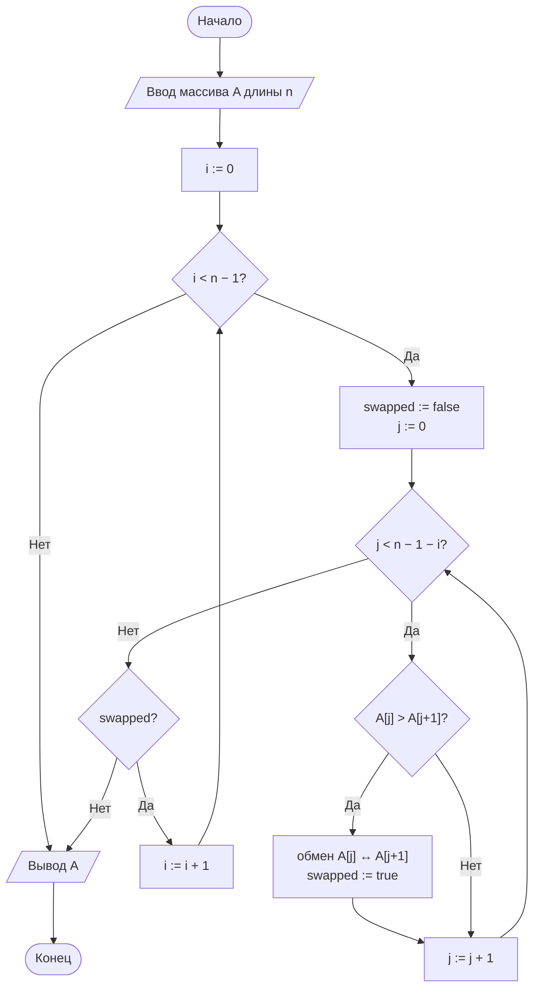
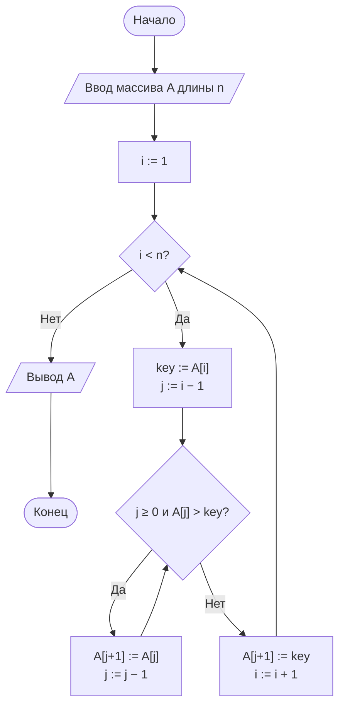
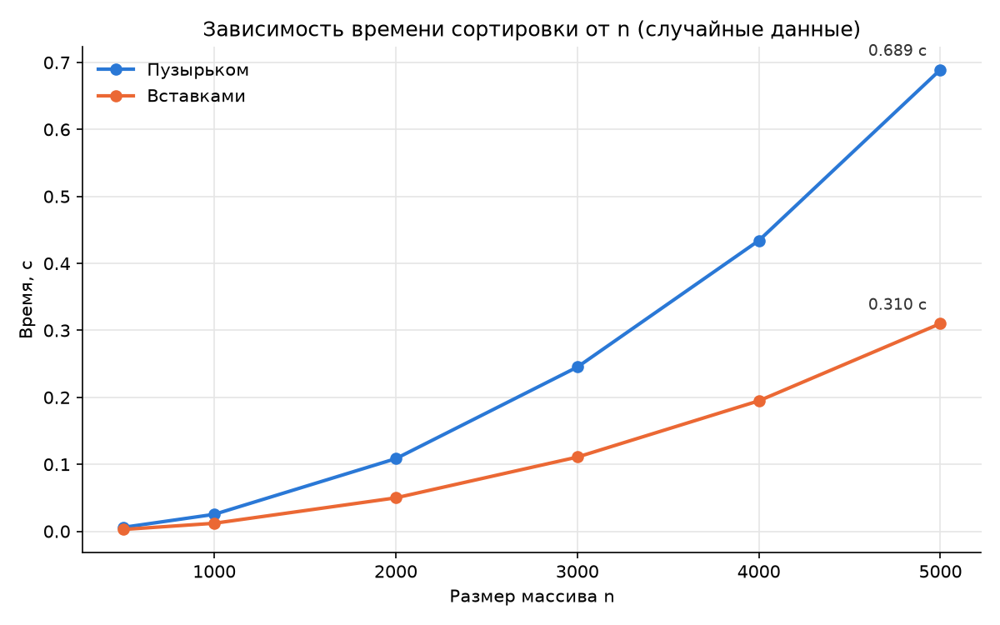

<div align="center">

**Дисциплина «Теория алгоритмов»**<br>
Направление подготовки 38.03.05 «Бизнес-информатика», 2 курс

# Отчёт по лабораторной работе № 2

### Эмпирический анализ временной сложности алгоритмов сортировки. Часть 1: квадратичные алгоритмы (сортировка обменом и сортировка вставками)

**Вариант 0**

Выполнил: студент группы ________ **Насруллаев И. Р.**<br>
Проверил: ________________

2026

</div>

---

## Содержание

1. [Цель и задачи работы](#1-цель-и-задачи-работы)
2. [Задание варианта](#2-задание-варианта)
3. [Описание алгоритмов и теоретические оценки](#3-описание-алгоритмов-и-теоретические-оценки)
4. [Блок-схемы алгоритмов](#4-блок-схемы-алгоритмов)
5. [Листинг программы](#5-листинг-программы)
6. [Условия эксперимента](#6-условия-эксперимента)
7. [Результаты измерений](#7-результаты-измерений)
8. [Выводы](#8-выводы)
9. [Ответы на контрольные вопросы](#9-ответы-на-контрольные-вопросы)

---

## 1. Цель и задачи работы

**Цель работы:** освоить методику экспериментального исследования временной сложности алгоритмов и сопоставить полученные эмпирические зависимости с теоретическими асимптотическими оценками на примере простых алгоритмов сортировки.

**Задачи:**

1. Изучить понятия вычислительной сложности, асимптотических обозначений $O$, $\Omega$, $\Theta$, а также лучшего, среднего и худшего случаев.
2. Реализовать сортировку обменом («пузырьком») и сортировку вставками.
3. Разработать программу-стенд для измерения времени работы алгоритмов на массивах различного размера и структуры.
4. Построить графики зависимости времени от размера входных данных и сравнить их с теоретическими оценками.
5. Сформулировать выводы о применимости алгоритмов.

## 2. Задание варианта

Сравнить время работы сортировки пузырьком (с флагом) и сортировки вставками на случайных целочисленных массивах.

| Размеры массива $n$ | Тип данных | Диапазон значений | Повторов $k$ | Доп. задание |
|---|---|---|---|---|
| 500, 1000, 2000, 3000, 4000, 5000 | R (случайные) | [0; 100 000] | 3 | — |

Каждое измерение повторяется 3 раза, результатом считается медиана.

## 3. Описание алгоритмов и теоретические оценки

Для квадратичного алгоритма $T(n) = \Theta(n^2)$, поэтому **при увеличении $n$ в 2 раза время работы должно возрастать примерно в 4 раза**, а отношение $T(n)/n^2$ должно оставаться приблизительно постоянным.

**Сортировка обменом (пузырьком).** Массив многократно просматривается слева направо, соседние элементы при нарушении порядка меняются местами. После $i$-го прохода $i$ наибольших элементов стоят на своих местах в конце массива. Флаг `swapped` позволяет завершить работу досрочно, если за проход не было ни одного обмена. На упорядоченном массиве достаточно одного прохода.

**Сортировка вставками.** Массив делится на отсортированную (левую) и неотсортированную (правую) части. Очередной элемент-ключ вставляется на своё место в отсортированной части, а бóльшие элементы сдвигаются вправо. Число сдвигов равно числу **инверсий** — пар $(i, j)$, где $i < j$ и $A[i] > A[j]$.

**Таблица 1. Теоретические оценки**

| Алгоритм | Лучший случай | Средний случай | Худший случай | Доп. память | Устойчивость |
|---|---|---|---|---|---|
| Пузырьком (с флагом) | $\Theta(n)$ | $\Theta(n^2)$ | $\Theta(n^2)$ | $O(1)$ | Да |
| Вставками | $\Theta(n)$ | $\Theta(n^2)$ | $\Theta(n^2)$ | $O(1)$ | Да |

На случайных данных сортировка вставками выполняет в среднем примерно вдвое меньше сравнений ($\approx n^2/4$ против $\approx n^2/2$), а сдвиг элемента дешевле обмена. Поэтому на практике она быстрее.

## 4. Блок-схемы алгоритмов

### 4.1. Сортировка пузырьком



### 4.2. Сортировка вставками



### 4.3. Экспериментальный стенд


## 5. Листинг программы

Вспомогательный модуль [`sorts_common.py`](sorts_common.py) (используется также в ЛР № 3):

```python
"""Общие функции для генерации данных и замера времени."""
import random
import statistics
import time


def generate_data(n, kind="random", lo=0, hi=100_000, seed=42):
    """Генерирует массив длины n заданного типа."""
    if kind == "duplicates":                 # тип D: много повторов
        lo, hi = 0, 10
    rng = random.Random(seed + n)      # воспроизводимость эксперимента
    data = [rng.randint(lo, hi) for _ in range(n)]
    if kind == "sorted":
        data.sort()
    elif kind == "reversed":
        data.sort(reverse=True)
    elif kind == "nearly_sorted":
        data.sort()
        for _ in range(max(1, n // 20)):          # 5 % случайных перестановок
            i, j = rng.randrange(n), rng.randrange(n)
            data[i], data[j] = data[j], data[i]
    return data


def measure(sort_func, data, repeats=3):
    """Возвращает медианное время работы sort_func на данных data, с."""
    times = []
    for _ in range(repeats):
        start = time.perf_counter()
        result = sort_func(data)
        times.append(time.perf_counter() - start)
        assert result == sorted(data), f"{sort_func.__name__}: ошибка сортировки"
    return statistics.median(times)
```

Основной модуль [`lr2.py`](lr2.py). Функции сортировки не изменяют исходный массив, а возвращают новый отсортированный список.

```python
"""
Лабораторная работа № 2. Вариант 0.
Сравнение сортировки пузырьком и сортировки вставками.
"""
from sorts_common import generate_data, measure


def bubble_sort(arr):
    """Сортировка пузырьком с флагом досрочного выхода."""
    a = arr.copy()
    n = len(a)
    for i in range(n - 1):
        swapped = False
        for j in range(n - 1 - i):
            if a[j] > a[j + 1]:
                a[j], a[j + 1] = a[j + 1], a[j]
                swapped = True
        if not swapped:
            break
    return a


def insertion_sort(arr):
    """Сортировка вставками."""
    a = arr.copy()
    for i in range(1, len(a)):
        key = a[i]
        j = i - 1
        while j >= 0 and a[j] > key:
            a[j + 1] = a[j]
            j -= 1
        a[j + 1] = key
    return a


if __name__ == "__main__":
    import matplotlib.pyplot as plt

    SIZES = [500, 1000, 2000, 3000, 4000, 5000]
    REPEATS = 3
    algorithms = {"Пузырьком": bubble_sort, "Вставками": insertion_sort}
    colors = {"Пузырьком": "#2a78d6", "Вставками": "#eb6834"}
    results = {name: [] for name in algorithms}

    print(f"{'n':>6}" + "".join(f"{name:>14}" for name in algorithms)
          + f"{'Пуз./Вст.':>12}")
    for n in SIZES:
        data = generate_data(n, kind="random")
        row = f"{n:>6}"
        for name, func in algorithms.items():
            t = measure(func, data, REPEATS)
            results[name].append(t)
            row += f"{t:>14.4f}"
        row += f"{results['Пузырьком'][-1] / results['Вставками'][-1]:>12.2f}"
        print(row)

    # Проверка квадратичного роста
    print("\nОтношение T(2n)/T(n), теория для Θ(n²): 4")
    for n in SIZES:
        if 2 * n in SIZES:
            i, j = SIZES.index(n), SIZES.index(2 * n)
            print(f"{n:>6} -> {2 * n:<6}" + "".join(
                f"{results[name][j] / results[name][i]:>14.2f}" for name in algorithms))

    print("\nОтношение T(n)/n² · 10⁸ (должно быть примерно постоянным)")
    for k, n in enumerate(SIZES):
        print(f"{n:>6}" + "".join(
            f"{results[name][k] / n ** 2 * 1e8:>14.2f}" for name in algorithms))

    fig, ax = plt.subplots(figsize=(8, 5))
    for name, times in results.items():
        ax.plot(SIZES, times, marker="o", markersize=6, linewidth=2,
                color=colors[name], label=name)
        ax.annotate(f"{times[-1]:.3f} с", (SIZES[-1], times[-1]),
                    textcoords="offset points", xytext=(-8, 8),
                    ha="right", fontsize=9, color="#333333")
    ax.set_xlabel("Размер массива n")
    ax.set_ylabel("Время, с")
    ax.set_title("Зависимость времени сортировки от n (случайные данные)")
    ax.grid(True, color="#e5e5e5", linewidth=0.8)
    ax.set_axisbelow(True)
    for side in ("top", "right"):
        ax.spines[side].set_visible(False)
    ax.legend(frameon=False)
    fig.tight_layout()
    fig.savefig("lr2_plot.png", dpi=150)
    plt.show()
```

Запуск (нужна библиотека `matplotlib`):

```bash
python lr2.py
```

Вывод программы сохранён в файле [`results.txt`](results.txt).

## 6. Условия эксперимента

| Параметр | Значение |
|---|---|
| Процессор | Intel Core i5-12400F (6 ядер / 12 потоков, базовая частота 2,5 ГГц) |
| Оперативная память | 16 ГБ |
| Операционная система | Windows 10 Домашняя, 64-бит (сборка 19045) |
| Интерпретатор | Python 3.14.0 (64-бит) |
| Таймер | `time.perf_counter()` |
| Генерация данных | `random.Random(42 + n)`, все алгоритмы получают копию одного и того же массива |

Абсолютные значения времени на другой системе будут отличаться, но соотношения между ними должны сохраниться.

## 7. Результаты измерений

**Таблица 2. Медианное время сортировки случайных массивов, с**

| $n$ | Пузырьком | Вставками | Отношение (пузырёк / вставки) |
|---|---|---|---|
| 500 | 0,0060 | 0,0028 | 2,14 |
| 1000 | 0,0253 | 0,0120 | 2,11 |
| 2000 | 0,1085 | 0,0500 | 2,17 |
| 3000 | 0,2452 | 0,1108 | 2,21 |
| 4000 | 0,4342 | 0,1948 | 2,23 |
| 5000 | 0,6893 | 0,3101 | 2,22 |

**Таблица 3. Проверка квадратичного роста: $T(2n)/T(n)$**

| Переход | Пузырьком | Вставками | Теоретическое значение |
|---|---|---|---|
| $500 \to 1000$ | 4,26 | 4,32 | 4 |
| $1000 \to 2000$ | 4,28 | 4,17 | 4 |
| $2000 \to 4000$ | 4,00 | 3,90 | 4 |

**Таблица 4. Отношение $T(n)/n^2 \cdot 10^{8}$, с**

| $n$ | Пузырьком | Вставками |
|---|---|---|
| 500 | 2,38 | 1,11 |
| 1000 | 2,53 | 1,20 |
| 2000 | 2,71 | 1,25 |
| 3000 | 2,72 | 1,23 |
| 4000 | 2,71 | 1,22 |
| 5000 | 2,76 | 1,24 |

**Рисунок 1. Зависимость времени сортировки от размера массива**



Обе зависимости имеют вид параболы, причём кривая сортировки пузырьком лежит выше.

## 8. Выводы

1. Эксперимент подтверждает квадратичную сложность $\Theta(n^2)$ обоих алгоритмов в среднем случае. При удвоении размера массива время возрастает в 3,9–4,3 раза при теоретическом значении 4 (табл. 3). Отношение $T(n)/n^2$ начиная с $n = 2000$ практически постоянно: 2,71–2,76 для пузырька и 1,22–1,25 для вставок (табл. 4). При $n = 500$–$1000$ оно немного ниже. Вероятная причина — маленький массив целиком помещается в быструю кэш-память процессора. Также сказываются накладные расходы интерпретатора.
2. Сортировка вставками на случайных данных стабильно быстрее сортировки пузырьком в 2,1–2,2 раза. Это согласуется с теорией: она выполняет в среднем вдвое меньше сравнений ($n^2/4$ против $n^2/2$), а сдвиг одного элемента дешевле обмена двух.
3. Оба алгоритма применимы лишь для небольших объёмов данных (до нескольких тысяч элементов). Экстраполяция по формуле $T(n) \approx T(5000) \cdot (n / 5000)^2$ показывает, что сортировка 100 000 записей заняла бы пузырьком $\approx 0{,}689 \cdot 400 \approx 276$ с (около 4,6 мин), а вставками $\approx 124$ с (около 2 мин). Для информационных систем это неприемлемо. Для больших массивов нужны алгоритмы со сложностью $O(n \log n)$, которые рассматриваются в [ЛР № 3](../lab3).

## 9. Ответы на контрольные вопросы

**1. Задача сортировки и примеры применения.** Дана последовательность $\langle a_1, \ldots, a_n \rangle$ с отношением порядка $\le$. Требуется найти её перестановку $\langle a'_1, \ldots, a'_n \rangle$, в которой $a'_1 \le a'_2 \le \ldots \le a'_n$. Примеры в бизнес-информатике: ранжирование клиентов по выручке (ABC-анализ), упорядочение транзакций по дате и времени для выписки или аудита, подготовка справочника товаров к бинарному поиску по артикулу.

**2. Обозначения $O$, $\Omega$, $\Theta$.** $T(n) = O(g(n))$, если $T(n) \le c \cdot g(n)$ при $n \ge n_0$ — оценка сверху («растёт не быстрее»). $T(n) = \Omega(g(n))$, если $T(n) \ge c \cdot g(n)$ при $n \ge n_0$ — оценка снизу («растёт не медленнее»). $T(n) = \Theta(g(n))$, если выполнены обе оценки — точный порядок роста.

**3. Лучший, средний и худший случаи.** Это время работы на самых «удобных» входных данных, в среднем по всем входам заданного размера и на самых «неудобных» входах. Худший случай для сортировки вставками — массив, упорядоченный по убыванию. Каждый новый ключ приходится сдвигать в самое начало, всего $n(n-1)/2$ сдвигов.

**4. Влияние флага `swapped`.** Без флага пузырёк всегда выполняет $n(n-1)/2$ сравнений. С флагом на уже упорядоченном массиве первый же проход завершается без обменов, и алгоритм останавливается после $n - 1$ сравнения. Лучший случай становится $\Theta(n)$ вместо $\Theta(n^2)$.

**5. Инверсия и трудоёмкость сортировки вставками.** Инверсия — пара позиций $i < j$, для которой $A[i] > A[j]$. Каждый сдвиг в сортировке вставками устраняет ровно одну инверсию, поэтому число сдвигов равно числу инверсий $I$, а время работы — $\Theta(n + I)$. В случайном массиве в среднем $I \approx n^2/4$, в почти упорядоченном $I$ мало, и время близко к линейному.

**6. Устойчивость сортировки.** Устойчивая сортировка сохраняет взаимный порядок элементов с равными ключами. Это важно при многоуровневой сортировке. Например, список заказов сначала сортируют по дате, затем устойчиво по фамилии клиента. Внутри каждого клиента заказы остаются упорядоченными по дате.

**7. Почему `perf_counter()`, а не `time()`.** `perf_counter()` — монотонный таймер наивысшего доступного разрешения, он не зависит от системных часов. `time()` возвращает «настенное» время. Его может сдвинуть синхронизация часов, и его разрешение ниже, поэтому для коротких интервалов он даёт искажённые результаты.

**8. Почему медиана, а не среднее.** Фоновые процессы ОС иногда замедляют отдельный замер в разы. Один такой выброс заметно сдвигает среднее арифметическое, а медиана от него почти не меняется.

**9. Почему при одинаковой асимптотике алгоритмы работают с разной скоростью.** Обозначение $\Theta(n^2)$ скрывает константный множитель. Он зависит от числа операций (у пузырька $\approx n^2/2$ сравнений, у вставок $\approx n^2/4$) и от стоимости каждой операции: обмен двух элементов дороже одного присваивания при сдвиге. В эксперименте эта константа отличается в 2,2 раза (табл. 4).

**10. Оценка времени сортировки 1 млн элементов.** По формуле $T(10^6) \approx T(5000) \cdot (10^6 / 5000)^2 = 40\,000 \cdot T(5000)$:

- пузырьком: $0{,}689 \cdot 40\,000 \approx 27\,600$ с, то есть около 7,7 ч;
- вставками: $0{,}310 \cdot 40\,000 \approx 12\,400$ с, то есть около 3,4 ч.

Отношение $T(n)/n^2$ с ростом $n$ слегка увеличивается (табл. 4), поэтому реальное время будет не меньше этих оценок.

---

**Литература**

1. Кормен Т., Лейзерсон Ч., Ривест Р., Штайн К. Алгоритмы: построение и анализ. — 3-е изд. — М.: Вильямс, 2013. — Гл. 2, 3.
2. Кнут Д. Э. Искусство программирования. Т. 3. Сортировка и поиск. — 2-е изд. — М.: Вильямс, 2017.
3. Седжвик Р., Уэйн К. Алгоритмы на Java. — 4-е изд. — М.: Вильямс, 2013. — Гл. 2.
4. Скиена С. Алгоритмы. Руководство по разработке. — 3-е изд. — СПб.: БХВ-Петербург, 2022.
5. Документация Python: модуль `time`. — URL: https://docs.python.org/3/library/time.html
