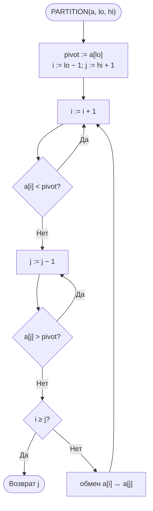
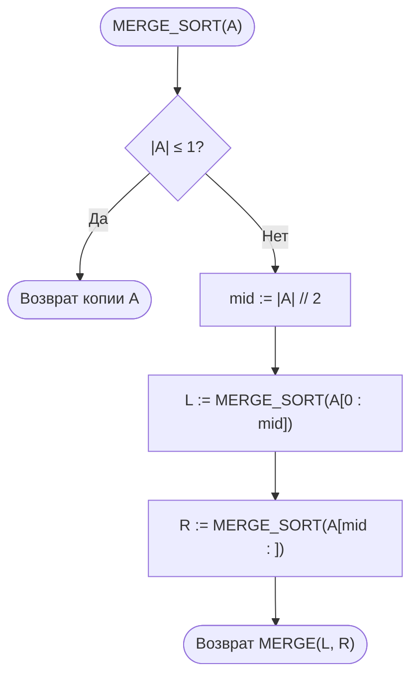
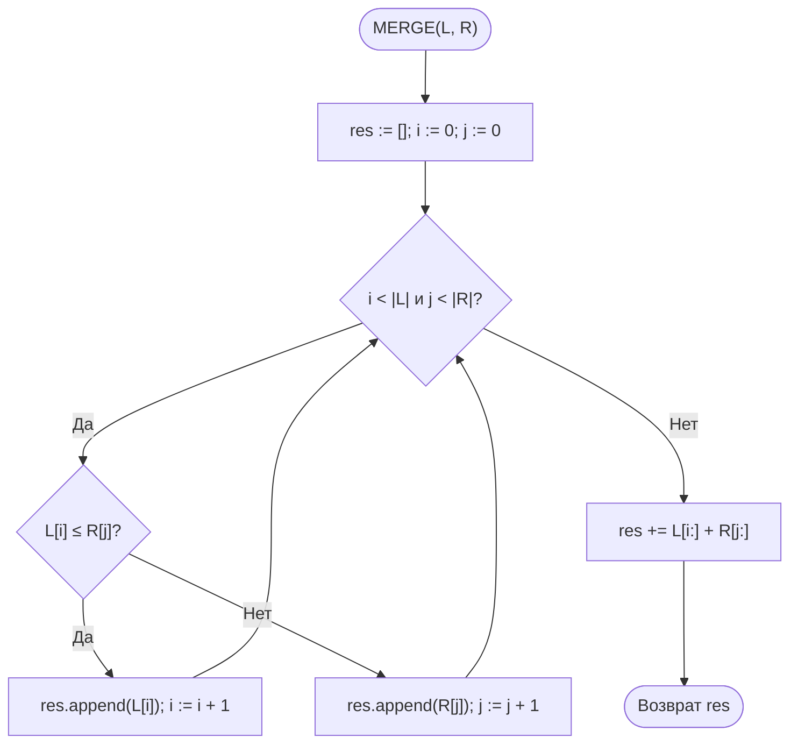
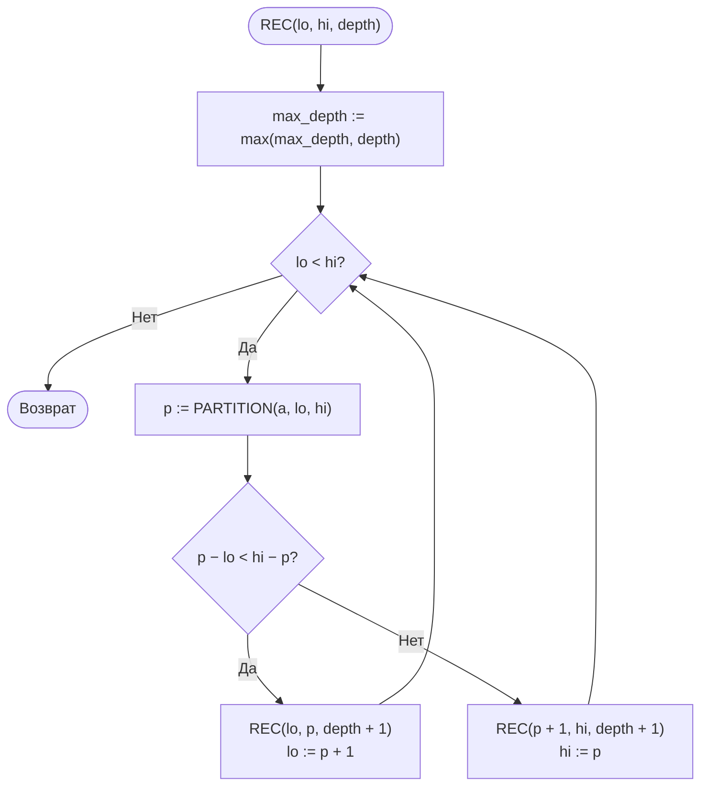

<div align="center">

**Дисциплина «Теория алгоритмов»**<br>
Направление подготовки 38.03.05 «Бизнес-информатика», 2 курс

# Отчёт по лабораторной работе № 3

### Эмпирический анализ временной сложности алгоритмов сортировки. Часть 2: алгоритмы на основе парадигмы «разделяй и властвуй» (быстрая сортировка и сортировка слиянием)

**Вариант 16**

Выполнил: студент группы ________ **Насруллаев И. Р.**<br>
Проверил: ________________

2026

</div>

---

## Содержание

1. [Цель и задачи работы](#1-цель-и-задачи-работы)
2. [Задание варианта](#2-задание-варианта)
3. [Описание алгоритмов и оценки сложности](#3-описание-алгоритмов-и-оценки-сложности)
4. [Блок-схемы алгоритмов](#4-блок-схемы-алгоритмов)
5. [Листинг программы](#5-листинг-программы)
6. [Условия эксперимента](#6-условия-эксперимента)
7. [Результаты экспериментов](#7-результаты-экспериментов)
8. [Сводная таблица](#8-сводная-таблица)
9. [Выводы и рекомендации](#9-выводы-и-рекомендации)
10. [Ответы на контрольные вопросы](#10-ответы-на-контрольные-вопросы)

---

## 1. Цель и задачи работы

**Цель работы:** изучить рекурсивные алгоритмы сортировки, построенные по принципу «разделяй и властвуй», экспериментально подтвердить их сложность $O(n \log n)$ и провести сравнительный анализ с квадратичными алгоритмами из [лабораторной работы № 2](../lab2).

**Задачи:**

1. Изучить парадигму «разделяй и властвуй» и метод анализа рекуррентных соотношений.
2. Реализовать быструю сортировку (Quick Sort) и сортировку слиянием (Merge Sort).
3. Сравнить четыре алгоритма (пузырьком, вставками, быструю, слиянием) на общем наборе размеров.
4. Сравнить быструю сортировку и сортировку слиянием между собой на больших массивах и на данных различной структуры, используя встроенную функцию `sorted()` как эталон.
5. Исследовать влияние выбора опорного элемента на производительность быстрой сортировки.

## 2. Задание варианта

| Опорный элемент | Схема разбиения | Сортировка слиянием | Размеры $n$ для эксперимента 2 | Доп. задание |
|---|---|---|---|---|
| П — первый | Х — Хоара | Н — нисходящая (рекурсивная) | 20 000; 30 000; 40 000; 50 000 | Г4 |

- **Эксперимент 1** — четыре алгоритма на размерах из ЛР № 2 (вариант 16): $n$ = 500, 1500, 2500, 3500, 4500, случайные данные из диапазона [0; 1 000 000].
- **Эксперимент 2** — быстрая сортировка, сортировка слиянием и `sorted()` на больших размерах.
- **Эксперимент 3** — быстрая сортировка и сортировка слиянием на данных типов R, S, V, N, D. Опорный элемент варианта — **первый**, поэтому, согласно примечанию к заданию, на упорядоченных (S) и обратно упорядоченных (V) данных эксперимент проводится при $n = 3000$. Для типов R, N, D он дополнительно проведён при $n = 50\,000$.
- **Дополнительное задание Г4** — измерить максимальную глубину рекурсии для каждого алгоритма на данных R, S, V и объяснить результаты.

Каждое измерение повторяется 5 раз, результатом считается медиана.

## 3. Описание алгоритмов и оценки сложности

**Парадигма «разделяй и властвуй»:** задача *разделяется* на подзадачи меньшего размера, подзадачи решаются рекурсивно (*властвование*), а их решения *комбинируются*. Трудоёмкость описывается рекуррентным соотношением

$$T(n) = a \cdot T\!\left(\frac{n}{b}\right) + f(n).$$

При делении пополам ($a = b = 2$) и линейных затратах $f(n) = \Theta(n)$ по основной теореме $T(n) = \Theta(n \log n)$: в дереве рекурсии $\approx \log_2 n$ уровней, и на каждом выполняется $\Theta(n)$ операций.

**Нижняя оценка.** Любая сортировка сравнением в худшем случае выполняет $\Omega(n \log n)$ сравнений: у дерева решений не меньше $n!$ листьев, и его высота не меньше $\log_2(n!) = \Theta(n \log n)$.

**Сортировка слиянием (нисходящая).** Массив делится пополам, половины сортируются рекурсивно и сливаются за $\Theta(n)$. Нестрогое сравнение `left[i] <= right[j]` при слиянии обеспечивает устойчивость. Рекуррентность одинакова во всех случаях:

$$T(n) = 2\,T(n/2) + \Theta(n) \;\Rightarrow\; T(n) = \Theta(n \log n).$$

Глубина рекурсии всегда равна $\lceil \log_2 n \rceil + 1$ и не зависит от данных. Недостаток — нужна $\Theta(n)$ дополнительной памяти.

**Быстрая сортировка (Хоара, первый опорный).** Опорным берётся первый элемент подмассива `a[lo]` — это классический вариант разбиения Хоара в изложении Кормена и др. Два указателя движутся навстречу друг другу и меняют местами пары элементов, стоящие «не на своей стороне». Функция разбиения возвращает индекс $j$, после чего рекурсивно сортируются части $[lo, j]$ и $[j + 1, hi]$. При опорном «первый элемент» всегда $j < hi$, поэтому обе части непусты и зацикливания нет. Комбинирование не требуется.

- Лучший и средний случаи — $\Theta(n \log n)$.
- Худший случай — $T(n) = T(n-1) + \Theta(n) = \Theta(n^2)$. Для первого опорного он наступает на **упорядоченных** данных (опорный — минимум, от подмассива отделяется один элемент) и на **обратно упорядоченных** (первое разбиение ставит максимум в конец, а минимум в начало, и дальше от подмассива отделяется по одному элементу).
- Чтобы глубина стека не превышала $O(\log n)$ даже в худшем случае, рекурсивно обрабатывается **меньшая** часть, а большая — в цикле. Время работы при этом не улучшается: от квадратичного времени защищает только выбор опорного элемента.

**Таблица 1. Сравнение алгоритмов сортировки (ЛР № 2 и № 3)**

| Алгоритм | Лучший | Средний | Худший | Доп. память | Устойчивость | Адаптивность |
|---|---|---|---|---|---|---|
| Пузырьком | $\Theta(n)$ | $\Theta(n^2)$ | $\Theta(n^2)$ | $O(1)$ | Да | Да (с флагом) |
| Вставками | $\Theta(n)$ | $\Theta(n^2)$ | $\Theta(n^2)$ | $O(1)$ | Да | Да |
| Слиянием | $\Theta(n \log n)$ | $\Theta(n \log n)$ | $\Theta(n \log n)$ | $\Theta(n)$ | Да | Нет |
| Быстрая (первый опорный) | $\Theta(n \log n)$ | $\Theta(n \log n)$ | $\Theta(n^2)$ на S и V | $O(\log n)$ | Нет | Нет (на S — наоборот, деградирует) |
| Timsort (`sorted`) | $\Theta(n)$ | $\Theta(n \log n)$ | $\Theta(n \log n)$ | $O(n)$ | Да | Да |

## 4. Блок-схемы алгоритмов

### 4.1. Быстрая сортировка


### 4.2. Разбиение Хоара (опорный — первый элемент)



### 4.3. Сортировка слиянием



### 4.4. Слияние двух упорядоченных массивов



### 4.5. Измерение глубины рекурсии (Г4)

Каждая сортировка дублируется «инструментированной» версией, которая передаёт в рекурсивный вызов текущую глубину `depth` и запоминает максимум. Схема для быстрой сортировки:



«Наивная» версия для сравнения вызывает `REC(lo, p, depth + 1)` и `REC(p + 1, hi, depth + 1)` рекурсивно обе. Для сортировки слиянием глубина считается как $\max$ глубин двух половин.

## 5. Листинг программы

Модуль [`lr3.py`](lr3.py). Он использует [`sorts_common.py`](../lab2/sorts_common.py) и [`lr2.py`](../lab2/lr2.py) из ЛР № 2. Функции сортировки не изменяют исходный массив.

```python
"""
Лабораторная работа № 3. Вариант 16.
Быстрая сортировка (Хоар, опорный — первый элемент) и нисходящая сортировка
слиянием. Сравнение с алгоритмами ЛР № 2 и встроенной sorted().
Доп. задание Г4: максимальная глубина рекурсии на данных R, S, V.
"""
import math
import sys
from pathlib import Path

# модули sorts_common.py и lr2.py лежат в папке ЛР № 2
sys.path.insert(0, str(Path(__file__).resolve().parent.parent / "lab2"))

from sorts_common import generate_data, measure  # noqa: E402
from lr2 import bubble_sort, insertion_sort      # noqa: E402

LO, HI = 0, 1_000_000             # диапазон значений (как в ЛР № 2)
REPEATS = 5                       # медиана из 5 замеров


# ---------- Быстрая сортировка ----------
def quick_sort(arr):
    a = arr.copy()
    _quick_sort(a, 0, len(a) - 1)
    return a


def _quick_sort(a, lo, hi):
    while lo < hi:
        p = _partition(a, lo, hi)
        # рекурсия в меньшую часть — глубина стека O(log n)
        if p - lo < hi - p:
            _quick_sort(a, lo, p)
            lo = p + 1
        else:
            _quick_sort(a, p + 1, hi)
            hi = p


def _partition(a, lo, hi):
    """Разбиение Хоара, опорный элемент — первый."""
    pivot = a[lo]
    i, j = lo - 1, hi + 1
    while True:
        i += 1
        while a[i] < pivot:
            i += 1
        j -= 1
        while a[j] > pivot:
            j -= 1
        if i >= j:
            return j
        a[i], a[j] = a[j], a[i]


# ---------- Сортировка слиянием ----------
def merge_sort(arr):
    if len(arr) <= 1:
        return arr.copy()
    mid = len(arr) // 2
    return _merge(merge_sort(arr[:mid]), merge_sort(arr[mid:]))


def _merge(left, right):
    result = []
    i = j = 0
    while i < len(left) and j < len(right):
        if left[i] <= right[j]:          # «<=» обеспечивает устойчивость
            result.append(left[i])
            i += 1
        else:
            result.append(right[j])
            j += 1
    result.extend(left[i:])
    result.extend(right[j:])
    return result


# ---------- Г4: глубина рекурсии ----------
def quick_depth(arr):
    """Максимальная глубина рекурсии quick_sort (рекурсия в меньшую часть)."""
    a = arr.copy()
    max_depth = 0

    def rec(lo, hi, depth):
        nonlocal max_depth
        max_depth = max(max_depth, depth)
        while lo < hi:
            p = _partition(a, lo, hi)
            if p - lo < hi - p:
                rec(lo, p, depth + 1)
                lo = p + 1
            else:
                rec(p + 1, hi, depth + 1)
                hi = p

    rec(0, len(a) - 1, 1)
    return max_depth


def quick_naive_depth(arr):
    """Глубина рекурсии «наивной» быстрой сортировки (два рекурсивных вызова)."""
    a = arr.copy()
    max_depth = 0

    def rec(lo, hi, depth):
        nonlocal max_depth
        max_depth = max(max_depth, depth)
        if lo < hi:
            p = _partition(a, lo, hi)
            rec(lo, p, depth + 1)
            rec(p + 1, hi, depth + 1)

    rec(0, len(a) - 1, 1)
    return max_depth


def merge_depth(arr, depth=1):
    """Максимальная глубина рекурсии merge_sort."""
    if len(arr) <= 1:
        return depth
    mid = len(arr) // 2
    return max(merge_depth(arr[:mid], depth + 1),
               merge_depth(arr[mid:], depth + 1))


# ---------- Эксперименты ----------
def run_experiment(algorithms, sizes, kind="random", repeats=REPEATS):
    results = {name: [] for name in algorithms}
    print(f"{'n':>8}" + "".join(f"{name:>12}" for name in algorithms))
    for n in sizes:
        data = generate_data(n, kind=kind, lo=LO, hi=HI)
        row = f"{n:>8}"
        for name, func in algorithms.items():
            t = measure(func, data, repeats)
            results[name].append(t)
            row += f"{t:>12.5f}"
        print(row)
    return results


if __name__ == "__main__":
    import matplotlib.pyplot as plt

    # один цвет на алгоритм во всех графиках
    COLORS = {"Пузырьком": "#2a78d6", "Вставками": "#eb6834",
              "Быстрая": "#1baf7a", "Слиянием": "#eda100",
              "sorted()": "#e87ba4"}
    KINDS = {"random": "R", "sorted": "S", "reversed": "V",
             "nearly_sorted": "N", "duplicates": "D"}

    # Эксперимент 1: четыре алгоритма на размерах из ЛР № 2
    print("Эксперимент 1: четыре алгоритма, случайные данные")
    small = [500, 1500, 2500, 3500, 4500]
    res1 = run_experiment({"Пузырьком": bubble_sort,
                           "Вставками": insertion_sort,
                           "Быстрая": quick_sort,
                           "Слиянием": merge_sort}, small)

    # Эксперимент 2: O(n log n) на больших размерах
    print("\nЭксперимент 2: алгоритмы O(n log n) на больших массивах")
    large = [20_000, 30_000, 40_000, 50_000]
    res2 = run_experiment({"Быстрая": quick_sort,
                           "Слиянием": merge_sort,
                           "sorted()": sorted}, large)
    print(f"\n{'n':>8}{'Слиянием / Быстрая':>22}{'Быстрая / sorted()':>22}")
    for k, n in enumerate(large):
        print(f"{n:>8}{res2['Слиянием'][k] / res2['Быстрая'][k]:>22.2f}"
              f"{res2['Быстрая'][k] / res2['sorted()'][k]:>22.2f}")

    # Проверка роста T(n2)/T(n1)
    print("\nОтношение T(n2)/T(n1)")
    print(f"{'Переход':>18}{'Быстрая':>10}{'Слиянием':>10}"
          f"{'n log n':>10}{'n²':>8}")
    pairs = list(zip(large, large[1:])) + [(large[0], 2 * large[0])]
    for n1, n2 in pairs:
        i, j = large.index(n1), large.index(n2)
        theory = n2 * math.log(n2) / (n1 * math.log(n1))
        print(f"{n1:>8} -> {n2:<7}"
              f"{res2['Быстрая'][j] / res2['Быстрая'][i]:>10.2f}"
              f"{res2['Слиянием'][j] / res2['Слиянием'][i]:>10.2f}"
              f"{theory:>10.2f}{(n2 / n1) ** 2:>8.2f}")

    # Эксперимент 3: влияние структуры данных.
    # Опорный «первый» на S и V даёт Θ(n²), поэтому для всех типов
    # берём n = 3000, а n = 50 000 — только для R, N, D.
    res3 = {}
    for n, kinds in ((3000, KINDS), (50_000, ("random", "nearly_sorted",
                                               "duplicates"))):
        print(f"\nЭксперимент 3, n = {n}")
        for kind in kinds:
            data = generate_data(n, kind=kind, lo=LO, hi=HI)
            tq = measure(quick_sort, data, REPEATS)
            tm = measure(merge_sort, data, REPEATS)
            res3[n, kind] = (tq, tm)
            print(f"{kind:>15} ({KINDS[kind]}): быстрая {tq:.5f} с, "
                  f"слиянием {tm:.5f} с, быстрая / слиянием {tq / tm:.2f}")

    print("\nКвадратичный рост быстрой сортировки на упорядоченных данных (S)")
    deg_sizes = [1000, 2000, 3000, 4000]
    deg = []
    for n in deg_sizes:
        t = measure(quick_sort, generate_data(n, kind="sorted", lo=LO, hi=HI),
                    REPEATS)
        deg.append(t)
        print(f"{n:>8}{t:>12.5f}{t / n ** 2 * 1e8:>12.2f} (T/n² · 10⁸)")

    # Г4: максимальная глубина рекурсии
    sys.setrecursionlimit(20_000)
    print("\nГ4. Максимальная глубина рекурсии")
    print(f"{'n':>8}{'Тип':>5}{'Быстрая':>10}{'Быстрая (наивн.)':>18}"
          f"{'Слиянием':>10}{'log2 n':>9}")
    depth = {}
    for n in (3000, 50_000):
        for kind in ("random", "sorted", "reversed"):
            data = generate_data(n, kind=kind, lo=LO, hi=HI)
            naive = (quick_naive_depth(data)
                     if n <= 3000 or kind == "random" else None)
            depth[n, kind] = (quick_depth(data), naive, merge_depth(data))
            print(f"{n:>8}{KINDS[kind]:>5}{depth[n, kind][0]:>10}"
                  f"{naive if naive is not None else '—':>18}"
                  f"{depth[n, kind][2]:>10}{math.log2(n):>9.2f}")

    # Сводная таблица при n = 4500
    print("\nСводная таблица, n = 4500, случайные данные")
    base = res1["Пузырьком"][-1]
    for name, times in res1.items():
        print(f"{name:>12}{times[-1]:>10.5f} с  ускорение x{base / times[-1]:.0f}")

    # Графики
    fig, axes = plt.subplots(1, 3, figsize=(17, 5))
    for name, t in res1.items():
        axes[0].plot(small, t, marker="o", markersize=6, linewidth=2,
                     color=COLORS[name], label=name)
    axes[0].set_yscale("log")
    axes[0].set_xticks(small)
    axes[0].set_title("Эксперимент 1 (лог. шкала времени)")
    for name, t in res2.items():
        axes[1].plot(large, t, marker="o", markersize=6, linewidth=2,
                     color=COLORS[name], label=name)
        axes[1].annotate(f"{t[-1]:.3f} с", (large[-1], t[-1]),
                         textcoords="offset points", xytext=(-8, 6),
                         ha="right", fontsize=9, color="#333333")
    axes[1].set_xticks(large)
    axes[1].set_title("Эксперимент 2")
    for ax in axes[:2]:
        ax.set_xlabel("Размер массива n")
    width = 0.38
    xs = range(len(KINDS))
    for idx, (shift, name) in enumerate(((-width / 2, "Быстрая"),
                                         (width / 2, "Слиянием"))):
        vals = [res3[3000, kind][idx] for kind in KINDS]
        bars = axes[2].bar([x + shift for x in xs], vals, width * 0.95,
                           color=COLORS[name], label=name)
        axes[2].bar_label(bars, fmt="%.4f", fontsize=8, padding=2,
                          color="#333333")
    axes[2].set_xticks(list(xs), list(KINDS.values()))
    axes[2].set_xlabel("Тип данных (n = 3000)")
    axes[2].set_title("Эксперимент 3 (опорный — первый элемент)")
    for ax in axes:
        ax.set_ylabel("Время, с")
        ax.grid(True, color="#e5e5e5", linewidth=0.8)
        ax.set_axisbelow(True)
        for side in ("top", "right"):
            ax.spines[side].set_visible(False)
        ax.legend(frameon=False)
    axes[2].grid(False, axis="x")
    fig.tight_layout()
    fig.savefig("lr3_plot.png", dpi=150)
    plt.show()
```

Запуск (нужна библиотека `matplotlib`; полный прогон занимает около 3 минут, бóльшая часть времени уходит на быструю сортировку упорядоченных массивов):

```bash
python lr3.py
```

Вывод программы сохранён в файле [`results.txt`](results.txt).

## 6. Условия эксперимента

| Параметр | Значение |
|---|---|
| Процессор | Intel Xeon @ 2,10 ГГц (виртуальная машина KVM, 4 vCPU) |
| Оперативная память | 16 ГБ |
| Операционная система | Linux, ядро 6.18, 64-бит |
| Интерпретатор | Python 3.13 (64-бит) |
| Таймер | `time.perf_counter()`, медиана из 5 замеров |
| Данные | `random.Random(42 + n)`, диапазон [0; 1 000 000]; для типа D — [0; 10] |
| Привязка к ядру | `taskset -c 3` |

Абсолютные значения времени зависят от вычислительной системы. Виртуальная машина делит процессор с другими задачами, поэтому отдельные замеры длительностью в единицы миллисекунд могут отклоняться на 10–20 %.

## 7. Результаты экспериментов

### 7.1. Эксперимент 1 — сравнение четырёх алгоритмов

**Таблица 2. Время сортировки случайных массивов, с**

| $n$ | Пузырьком | Вставками | Быстрая | Слиянием |
|---|---|---|---|---|
| 500 | 0,00902 | 0,00433 | 0,00043 | 0,00057 |
| 1500 | 0,08946 | 0,04247 | 0,00147 | 0,00200 |
| 2500 | 0,26022 | 0,12846 | 0,00317 | 0,00383 |
| 3500 | 0,49984 | 0,22737 | 0,00375 | 0,00527 |
| 4500 | 0,84869 | 0,38267 | 0,00474 | 0,00660 |

При $n = 4500$ быстрая сортировка опережает сортировку пузырьком примерно в 179 раз, а сортировку вставками — примерно в 81 раз. С ростом $n$ разрыв увеличивается: при $n = 500$ быстрая сортировка была быстрее пузырька лишь в 21 раз. На случайных данных первый опорный элемент работает не хуже любого другого: случайный элемент массива — в среднем «хороший» опорный.

### 7.2. Эксперимент 2 — алгоритмы $O(n \log n)$ на больших массивах

**Таблица 3. Время сортировки случайных массивов, с**

| $n$ | Быстрая | Слиянием | `sorted()` | Слиянием / Быстрая | Быстрая / `sorted()` |
|---|---|---|---|---|---|
| 20 000 | 0,02541 | 0,03340 | 0,00244 | 1,31 | 10,40 |
| 30 000 | 0,03564 | 0,05250 | 0,00494 | 1,47 | 7,21 |
| 40 000 | 0,05837 | 0,08035 | 0,00542 | 1,38 | 10,77 |
| 50 000 | 0,06771 | 0,10603 | 0,00761 | 1,57 | 8,90 |

**Таблица 4. Проверка роста $T(n_2)/T(n_1)$**

| Переход | Быстрая | Слиянием | Теория $O(n \log n)$ | Теория $O(n^2)$ |
|---|---|---|---|---|
| $20\,000 \to 30\,000$ | 1,40 | 1,57 | 1,56 | 2,25 |
| $30\,000 \to 40\,000$ | 1,64 | 1,53 | 1,37 | 1,78 |
| $40\,000 \to 50\,000$ | 1,16 | 1,32 | 1,28 | 1,56 |
| $20\,000 \to 40\,000$ | 2,30 | 2,41 | 2,14 | 4,00 |
| $20\,000 \to 50\,000$ | 2,66 | 3,17 | 2,73 | 6,25 |

Теоретическое значение для $O(n \log n)$ вычислено по формуле

$$\frac{T(n_2)}{T(n_1)} \approx \frac{n_2 \ln n_2}{n_1 \ln n_1}.$$

### 7.3. Эксперимент 3 — влияние структуры данных

**Таблица 5. Время сортировки данных разной структуры при $n = 3000$, с**

| Тип данных | Быстрая | Слиянием | Быстрая / Слиянием |
|---|---|---|---|
| Случайные (R) | 0,00302 | 0,00439 | 0,69 |
| Упорядоченные (S) | **0,16394** | 0,00293 | **56,0** |
| Обратно упорядоченные (V) | **0,15687** | 0,00428 | **36,7** |
| Почти упорядоченные (N) | 0,00598 | 0,00436 | 1,37 |
| С большим числом повторов (D) | 0,00263 | 0,00407 | 0,65 |

**Таблица 6. Время сортировки при $n = 50\,000$ (только типы R, N, D), с**

| Тип данных | Быстрая | Слиянием | Быстрая / Слиянием |
|---|---|---|---|
| Случайные (R) | 0,07477 | 0,10903 | 0,69 |
| Почти упорядоченные (N) | 0,10413 | 0,09765 | 1,07 |
| С большим числом повторов (D) | 0,07420 | 0,08571 | 0,87 |

**Таблица 7. Быстрая сортировка упорядоченных массивов (S): квадратичный рост**

| $n$ | Время, с | $T(n)/n^2 \cdot 10^8$ |
|---|---|---|
| 1000 | 0,01904 | 1,90 |
| 2000 | 0,07579 | 1,89 |
| 3000 | 0,16641 | 1,85 |
| 4000 | 0,29593 | 1,85 |

Отношение $T(n)/n^2$ постоянно, то есть на упорядоченных данных быстрая сортировка с первым опорным работает за $\Theta(n^2)$ — так же, как сортировки из ЛР № 2. Экстраполяция на $n = 50\,000$ даёт $\approx \text{1,86} \cdot 10^{-8} \cdot \text{2,5} \cdot 10^{9} \approx 47$ с на один запуск — в 600 раз дольше, чем на случайных данных того же размера. Именно поэтому для типов S и V эксперимент ограничен размером $n \le 3000$.

### 7.4. Дополнительное задание Г4 — максимальная глубина рекурсии

**Таблица 8. Максимальная глубина рекурсии (число вложенных вызовов, считая внешний)**

| $n$ | Тип | Быстрая (рекурсия в меньшую часть) | Быстрая «наивная» (два рекурсивных вызова) | Слиянием | $\log_2 n$ |
|---|---|---|---|---|---|
| 3000 | R | 9 | 28 | 13 | 11,55 |
| 3000 | S | 2 | **3000** | 13 | 11,55 |
| 3000 | V | 3 | **2996** | 13 | 11,55 |
| 50 000 | R | 12 | 41 | 17 | 15,61 |
| 50 000 | S | 3 | — | 17 | 15,61 |
| 50 000 | V | 3 | — | 17 | 15,61 |

«Наивная» версия на S и V при $n = 50\,000$ не запускалась: потребовалась бы глубина рекурсии около 50 000 (стандартный лимит Python — 1000) и около минуты работы на один запуск. Для $n = 3000$ лимит был поднят вызовом `sys.setrecursionlimit(20_000)`.

### 7.5. Графики

**Рисунок 1. Эксперименты 1–3**


На левом графике (логарифмическая шкала времени) кривые квадратичных алгоритмов лежат на 1–2 порядка выше кривых алгоритмов $O(n \log n)$ и растут круче. На среднем графике зависимость для быстрой сортировки и сортировки слиянием близка к линейной ($n \log n$ растёт лишь немного быстрее $n$), кривая `sorted()` лежит у самой оси. На правом графике видна деградация быстрой сортировки с первым опорным на типах S и V: при $n = 3000$ она в 37–56 раз медленнее сортировки слиянием.

## 8. Сводная таблица

**Таблица 9. Итоговое сравнение ($n = 4500$, случайные данные)**

| Алгоритм | Теор. сложность (средняя) | Время, с | Ускорение относительно пузырька | Память | Устойчивость | Глубина рекурсии ($n = 3000$, R / S) |
|---|---|---|---|---|---|---|
| Пузырьком | $\Theta(n^2)$ | 0,84869 | 1 | $O(1)$ | Да | — |
| Вставками | $\Theta(n^2)$ | 0,38267 | 2,2 | $O(1)$ | Да | — |
| Слиянием | $\Theta(n \log n)$ | 0,00660 | 129 | $\Theta(n)$ | Да | 13 / 13 |
| Быстрая (первый опорный) | $\Theta(n \log n)$, на S и V $\Theta(n^2)$ | 0,00474 | 179 | $O(\log n)$ | Нет | 9 / 2 |

## 9. Выводы и рекомендации

1. Эксперимент подтвердил принципиальное различие классов сложности. На логарифмическом графике кривые квадратичных алгоритмов растут значительно круче, а уже при $n = 4500$ алгоритмы $O(n \log n)$ быстрее в 58–179 раз (табл. 2, 9).
2. Для быстрой сортировки и сортировки слиянием рост времени соответствует $\Theta(n \log n)$. На всём диапазоне $20\,000 \to 50\,000$ время выросло в 2,66 и 3,17 раза при теоретическом значении 2,73 и квадратичном 6,25 (табл. 4). Отношения для соседних размеров колеблются вокруг теории (1,16–1,64 при теоретических 1,28–1,56): интервалы в несколько десятков миллисекунд на виртуальной машине измеряются с погрешностью 10–20 %.
3. На случайных данных быстрая сортировка опережает сортировку слиянием в 1,3–1,6 раза (табл. 3). Причины: она работает на месте, тогда как сортировка слиянием на каждом уровне рекурсии создаёт срезы и новые списки, а также имеет меньшую константу в оценке.
4. **Выбор первого элемента опорным — главная слабость варианта.** На упорядоченных (S) и обратно упорядоченных (V) данных быстрая сортировка деградирует до $\Theta(n^2)$: при $n = 3000$ она в 37–56 раз медленнее сортировки слиянием (табл. 5), а отношение $T(n)/n^2$ постоянно (табл. 7). Причина — опорный элемент оказывается минимумом (S) или после первого обмена максимум и минимум встают по краям (V), и каждое разбиение отделяет от подмассива лишь один элемент. Поэтому эксперимент на этих типах проведён только при $n \le 3000$: при $n = 50\,000$ один запуск занял бы около 47 с вместо 0,07 с.
5. На почти упорядоченных данных (N) деградация частичная: быстрая сортировка на 39 % медленнее, чем на случайных, и уже уступает сортировке слиянием (табл. 6). Внутри почти упорядоченных участков первый элемент близок к минимуму, и разбиения несбалансированы. На данных с повторами (D) деградации нет: схема Хоара останавливает оба указателя на элементах, равных опорному, и распределяет их по обеим частям.
6. Сортировка слиянием ведёт себя одинаково на всех типах данных (0,0029–0,0044 с при $n = 3000$). На упорядоченных данных (S) она даже немного быстрее: при слиянии левая половина «исчерпывается» раньше правой, и цикл сравнений короче.
7. **Дополнительное задание Г4 — глубина рекурсии (табл. 8).**
   - *Сортировка слиянием*: глубина равна $\lceil \log_2 n \rceil + 1$ (13 при $n = 3000$, 17 при $n = 50\,000$) и **не зависит от данных**, так как массив всегда делится ровно пополам.
   - *Быстрая сортировка с рекурсией в меньшую часть*: глубина на R (9 и 12) не превышает $\log_2 n$, как и гарантирует этот приём. На S и V глубина минимальна (2–3): от подмассива отделяется один элемент, и рекурсивный вызов для него сразу завершается, а большая часть обрабатывается в цикле без новых вызовов. **Малая глубина здесь не означает быстрой работы**: именно на S и V время квадратичное. Приём защищает стек, но не время.
   - *«Наивная» быстрая сортировка*: на R глубина 28 и 41, то есть примерно $2{,}5 \log_2 n$ — разбиения случайны и не идеально сбалансированы. На S и V глубина равна $n$ (3000 и 2996): каждый уровень рекурсии уменьшает подмассив на 1–2 элемента. При стандартном лимите Python (1000 вызовов) такая реализация завершилась бы ошибкой `RecursionError` уже при $n > 1000$.
8. Встроенная функция `sorted()` работает в 7–11 раз быстрее собственной быстрой сортировки и в 11–15 раз быстрее сортировки слиянием (табл. 3). Причины — реализация на C и гибридный адаптивный алгоритм. **В прикладных информационных системах следует использовать стандартные библиотечные средства сортировки.** Собственные реализации оправданы лишь в учебных целях или при особых требованиях.
9. **Рекомендации по выбору.** Быструю сортировку с первым (или последним) опорным элементом нельзя применять к данным, которые могут быть уже упорядочены, — а в информационных системах это частый случай (выгрузки, отсортированные по дате или по коду). Нужно выбирать опорный случайно, из середины или как медиану трёх. Если требуется устойчивость (многоуровневая сортировка отчётов) или гарантированное время $\Theta(n \log n)$ на любых данных, следует использовать сортировку слиянием. Для малых ($n < 50$) или почти упорядоченных массивов подходит сортировка вставками.

## 10. Ответы на контрольные вопросы

**1. Три этапа «разделяй и властвуй» на примере сортировки слиянием.** *Разделение:* массив делится пополам по индексу `mid`. *Властвование:* каждая половина сортируется рекурсивно, массив из 0 или 1 элемента уже упорядочен (базовый случай). *Комбинирование:* две упорядоченные половины сливаются в одну за $\Theta(n)$.

**2. Рекуррентность сортировки слиянием и её решение деревом рекурсии.** $T(n) = 2\,T(n/2) + cn$, $T(1) = c$. На уровне $i$ дерева $2^i$ подзадач размера $n/2^i$, затраты уровня $2^i \cdot c\,n/2^i = cn$. Уровней $\log_2 n + 1$, поэтому $T(n) = cn(\log_2 n + 1) = \Theta(n \log n)$. Число уровней совпадает с измеренной глубиной рекурсии в задании Г4: 13 при $n = 3000$.

**3. Почему сортировка сравнением требует $\Omega(n \log n)$ сравнений.** Работу алгоритма можно представить двоичным деревом решений: каждый узел — сравнение, каждый лист — одна из перестановок. Чтобы различить все $n!$ перестановок, нужно не меньше $n!$ листьев. Высота дерева, то есть число сравнений в худшем случае, не меньше $\log_2(n!) \approx n \log_2 n - \text{1,44}n = \Omega(n \log n)$ (по формуле Стирлинга).

**4. Худшие данные для опорного «первый элемент».** Упорядоченный и обратно упорядоченный массивы — это подтверждено экспериментом (табл. 5, 7). На упорядоченном массиве первый элемент — минимум, разбиение даёт части размером $1$ и $n - 1$, и $T(n) = T(n-1) + \Theta(n) = \Theta(n^2)$. При наивной рекурсии глубина достигает $n$ (3000 в табл. 8), и в Python возникает `RecursionError`.

**5. Схемы Ломуто и Хоара.** Ломуто: один указатель проходит массив слева направо, опорный обычно последний, элементы меньше опорного переносятся в начало. Схема проще, но выполняет больше обменов и деградирует на массивах с повторами. Хоар: два указателя движутся навстречу друг другу и меняют местами пару «неправильных» элементов. Обменов в среднем примерно втрое меньше, равные элементы делятся поровну (поэтому в нашем эксперименте тип D не вызвал деградации), и на практике схема быстрее.

**6. Как рандомизация защищает от худшего случая.** При случайном выборе опорного элемента нет фиксированных входных данных, которые всегда приводят к плохим разбиениям. Худший случай возможен лишь при крайне маловероятной серии неудачных выборов. Математическое ожидание времени равно $\Theta(n \log n)$ для любого входа, в том числе для упорядоченного, на котором наш вариант с первым опорным работает в 56 раз медленнее сортировки слиянием.

**7. Почему быстрая сортировка на практике быстрее сортировки слиянием.** Она работает на месте, не выделяет память под новые списки и обращается к соседним ячейкам, эффективно используя кэш. Константа в $\Theta(n \log n)$ у неё меньше. В эксперименте на случайных данных быстрая сортировка опередила сортировку слиянием в 1,3–1,6 раза. Но это верно только при удачном выборе опорного: на S и V в нашем варианте картина обратная.

**8. Как ограничить глубину рекурсии величиной $O(\log n)$.** Рекурсивно сортировать только **меньшую** из двух частей, а большую обрабатывать в цикле (`while lo < hi`), меняя границы. Меньшая часть не больше половины текущей, поэтому каждый вложенный вызов работает с вдвое меньшим массивом, и глубина не превышает $\log_2 n$. Задание Г4 это подтвердило: на тех же данных S, где наивная версия уходит на глубину 3000, версия с этим приёмом не превышает глубины 3.

**9. Почему сортировка слиянием устойчива, а быстрая — нет.** При слиянии равных элементов первым берётся элемент из левой половины (сравнение `<=`), поэтому исходный порядок равных сохраняется. Быстрая сортировка меняет местами далеко стоящие элементы, «перепрыгивая» через равные. Например, у записей (Москва, 100), (Казань, 100), (Омск, 50) при сортировке по выручке обмен может поставить «Казань» перед «Москвой».

**10. Идеи Timsort и роль сортировки вставками.** Timsort ищет во входных данных уже упорядоченные участки (runs); убывающие участки разворачивает. Короткие участки дополняет до минимальной длины (32–64) сортировкой вставками с бинарным поиском. Затем участки попарно сливаются по правилам, удерживающим их размеры сбалансированными (в Python 3.11+ — стратегия Powersort), с ускорением «галопом» при длинных сериях из одного участка. Поэтому упорядоченные данные для `sorted()` — лучший случай $\Theta(n)$, а не худший, как для нашей быстрой сортировки. Сортировка вставками используется для коротких массивов, потому что у неё минимальные накладные расходы, нет рекурсии, она устойчива и быстро работает на почти упорядоченных данных.

**11. Сортировка 10 млн транзакций при нехватке памяти.** Нужна **внешняя сортировка слиянием**. Файл читается частями, которые помещаются в память. Каждая часть сортируется в памяти (например, `sorted()`) и записывается на диск как отсортированный участок. Затем все участки сливаются за один или несколько проходов k-путевым слиянием с кучей (`heapq.merge`), при этом данные читаются с диска последовательно. Сортировка слиянием подходит потому, что работает с последовательным доступом и не требует держать весь массив в памяти.

---

**Литература**

1. Кормен Т., Лейзерсон Ч., Ривест Р., Штайн К. Алгоритмы: построение и анализ. — 3-е изд. — М.: Вильямс, 2013. — Гл. 2, 4, 7, 8.
2. Седжвик Р., Уэйн К. Алгоритмы на Java. — 4-е изд. — М.: Вильямс, 2013. — Гл. 2.
3. Hoare C. A. R. Quicksort // The Computer Journal. — 1962. — Vol. 5, No. 1. — P. 10–16.
4. Скиена С. Алгоритмы. Руководство по разработке. — 3-е изд. — СПб.: БХВ-Петербург, 2022.
5. Кнут Д. Э. Искусство программирования. Т. 3. Сортировка и поиск. — 2-е изд. — М.: Вильямс, 2017.
6. Peters T. Timsort description (listsort.txt). — URL: https://github.com/python/cpython/blob/main/Objects/listsort.txt
