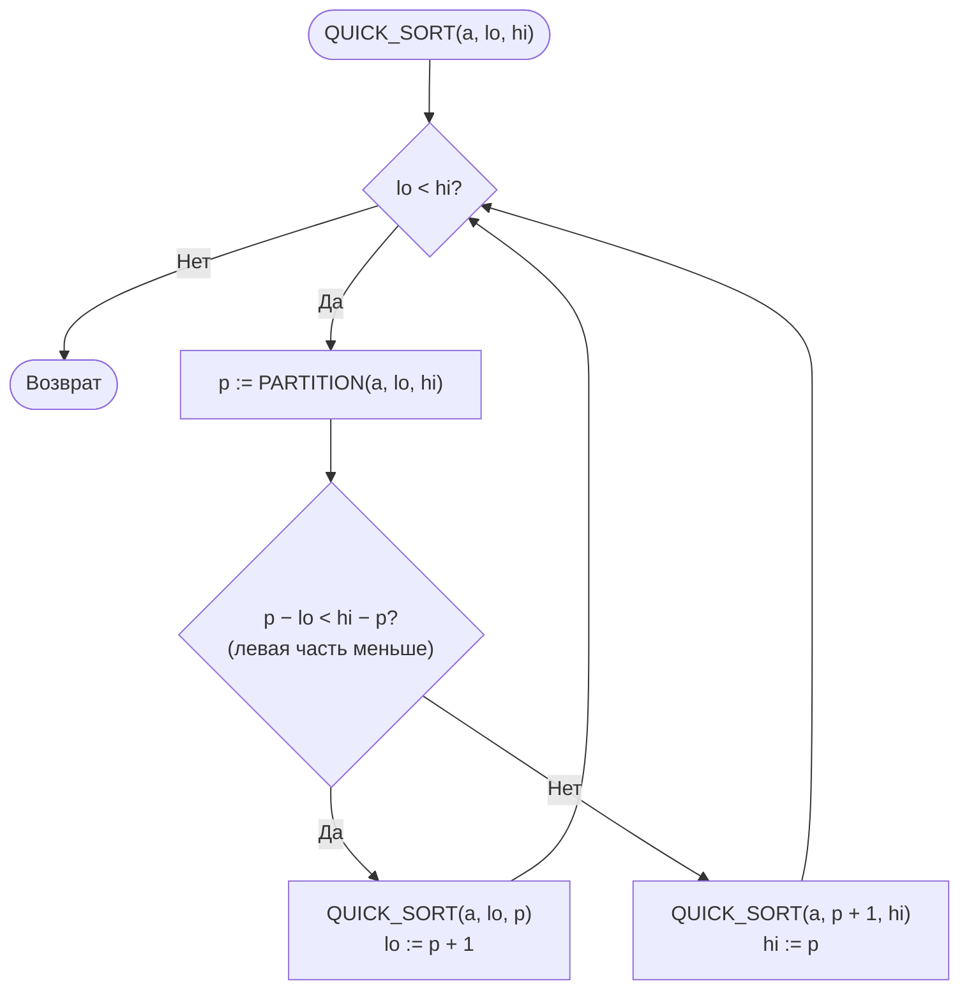
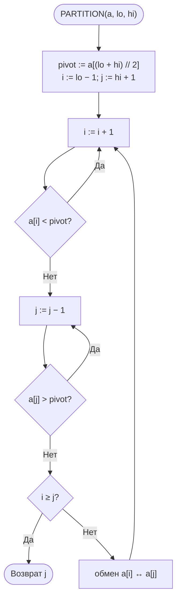

<div align="center">

**Дисциплина «Теория алгоритмов»**<br>
Направление подготовки 38.03.05 «Бизнес-информатика», 2 курс

# Отчёт по лабораторной работе № 3

### Эмпирический анализ временной сложности алгоритмов сортировки. Часть 2: алгоритмы на основе парадигмы «разделяй и властвуй» (быстрая сортировка и сортировка слиянием)

**Вариант 0**

Выполнил: студент группы ________ **Насруллаев И. Р.**<br>
Проверил: ________________

2026

</div>

---

## Содержание

1. [Цель и задачи работы](#1-цель-и-задачи-работы)
2. [Задание варианта](#2-задание-варианта)
3. [Описание алгоритмов и оценки сложности](#3-описание-алгоритмов-и-оценки-сложности)
4. [Блок-схемы алгоритмов](#4-блок-схемы-алгоритмов)
5. [Листинг программы](#5-листинг-программы)
6. [Условия эксперимента](#6-условия-эксперимента)
7. [Результаты экспериментов](#7-результаты-экспериментов)
8. [Сводная таблица](#8-сводная-таблица)
9. [Выводы и рекомендации](#9-выводы-и-рекомендации)
10. [Ответы на контрольные вопросы](#10-ответы-на-контрольные-вопросы)

---

## 1. Цель и задачи работы

**Цель работы:** изучить рекурсивные алгоритмы сортировки, построенные по принципу «разделяй и властвуй», экспериментально подтвердить их сложность $O(n \log n)$ и провести сравнительный анализ с квадратичными алгоритмами из [лабораторной работы № 2](../lab2).

**Задачи:**

1. Изучить парадигму «разделяй и властвуй» и метод анализа рекуррентных соотношений.
2. Реализовать быструю сортировку (Quick Sort) и сортировку слиянием (Merge Sort).
3. Сравнить четыре алгоритма (пузырьком, вставками, быструю, слиянием) на общем наборе размеров.
4. Сравнить быструю сортировку и сортировку слиянием между собой на больших массивах и на данных различной структуры, используя встроенную функцию `sorted()` как эталон.
5. Исследовать влияние выбора опорного элемента на производительность быстрой сортировки.

## 2. Задание варианта

| Опорный элемент | Схема разбиения | Сортировка слиянием | Размеры $n$ для эксперимента 2 | Доп. задание |
|---|---|---|---|---|
| средний | Хоара | нисходящая (рекурсивная) | 10 000; 25 000; 50 000; 100 000; 200 000 | — |

- **Эксперимент 1** — четыре алгоритма на размерах из ЛР № 2: $n$ = 500, 1000, 2000, 3000, 4000, 5000, случайные данные.
- **Эксперимент 2** — быстрая сортировка, сортировка слиянием и `sorted()` на больших размерах.
- **Эксперимент 3** — быстрая сортировка и сортировка слиянием на данных типов R, S, V, N, D при $n = 50\,000$.

Каждое измерение повторяется 3 раза, результатом считается медиана.

## 3. Описание алгоритмов и оценки сложности

**Парадигма «разделяй и властвуй»:** задача *разделяется* на подзадачи меньшего размера, подзадачи решаются рекурсивно (*властвование*), а их решения *комбинируются*. Трудоёмкость описывается рекуррентным соотношением

$$T(n) = a \cdot T\!\left(\frac{n}{b}\right) + f(n).$$

При делении пополам ($a = b = 2$) и линейных затратах $f(n) = \Theta(n)$ по основной теореме $T(n) = \Theta(n \log n)$: в дереве рекурсии $\approx \log_2 n$ уровней, и на каждом выполняется $\Theta(n)$ операций.

**Нижняя оценка.** Любая сортировка сравнением в худшем случае выполняет $\Omega(n \log n)$ сравнений: у дерева решений не меньше $n!$ листьев, и его высота не меньше $\log_2(n!) = \Theta(n \log n)$.

**Сортировка слиянием (нисходящая).** Массив делится пополам, половины сортируются рекурсивно и сливаются за $\Theta(n)$. Нестрогое сравнение `left[i] <= right[j]` при слиянии обеспечивает устойчивость. Рекуррентность одинакова во всех случаях:

$$T(n) = 2\,T(n/2) + \Theta(n) \;\Rightarrow\; T(n) = \Theta(n \log n).$$

Недостаток — нужна $\Theta(n)$ дополнительной памяти.

**Быстрая сортировка (Хоара, средний опорный).** Опорным берётся элемент из середины подмассива. Два указателя движутся навстречу друг другу и меняют местами пары элементов, стоящие «не на своей стороне». Затем обе части сортируются рекурсивно, комбинирование не требуется. Лучший и средний случаи — $\Theta(n \log n)$, худший — $T(n) = T(n-1) + \Theta(n) = \Theta(n^2)$. Чтобы глубина стека не превышала $O(\log n)$, рекурсивно обрабатывается **меньшая** часть, а большая — в цикле.

**Таблица 1. Сравнение алгоритмов сортировки (ЛР № 2 и № 3)**

| Алгоритм | Лучший | Средний | Худший | Доп. память | Устойчивость | Адаптивность |
|---|---|---|---|---|---|---|
| Пузырьком | $\Theta(n)$ | $\Theta(n^2)$ | $\Theta(n^2)$ | $O(1)$ | Да | Да (с флагом) |
| Вставками | $\Theta(n)$ | $\Theta(n^2)$ | $\Theta(n^2)$ | $O(1)$ | Да | Да |
| Слиянием | $\Theta(n \log n)$ | $\Theta(n \log n)$ | $\Theta(n \log n)$ | $\Theta(n)$ | Да | Нет |
| Быстрая | $\Theta(n \log n)$ | $\Theta(n \log n)$ | $\Theta(n^2)$ | $O(\log n)$ | Нет | Нет |
| Timsort (`sorted`) | $\Theta(n)$ | $\Theta(n \log n)$ | $\Theta(n \log n)$ | $O(n)$ | Да | Да |

## 4. Блок-схемы алгоритмов

### 4.1. Быстрая сортировка



### 4.2. Разбиение Хоара



### 4.3. Сортировка слиянием


### 4.4. Слияние двух упорядоченных массивов


## 5. Листинг программы

Модуль [`lr3.py`](lr3.py). Он использует [`sorts_common.py`](../lab2/sorts_common.py) и [`lr2.py`](../lab2/lr2.py) из ЛР № 2. Функции сортировки не изменяют исходный массив.

```python
"""
Лабораторная работа № 3. Вариант 0.
Быстрая сортировка (Хоар, средний опорный) и сортировка слиянием.
Сравнение с алгоритмами ЛР № 2 и встроенной sorted().
"""
import math
import sys
from pathlib import Path

# модули sorts_common.py и lr2.py лежат в папке ЛР № 2
sys.path.insert(0, str(Path(__file__).resolve().parent.parent / "lab2"))

from sorts_common import generate_data, measure  # noqa: E402
from lr2 import bubble_sort, insertion_sort      # noqa: E402


# ---------- Быстрая сортировка ----------
def quick_sort(arr):
    a = arr.copy()
    _quick_sort(a, 0, len(a) - 1)
    return a


def _quick_sort(a, lo, hi):
    while lo < hi:
        p = _partition(a, lo, hi)
        # рекурсия в меньшую часть — глубина стека O(log n)
        if p - lo < hi - p:
            _quick_sort(a, lo, p)
            lo = p + 1
        else:
            _quick_sort(a, p + 1, hi)
            hi = p


def _partition(a, lo, hi):
    """Разбиение Хоара, опорный элемент — средний."""
    pivot = a[(lo + hi) // 2]
    i, j = lo - 1, hi + 1
    while True:
        i += 1
        while a[i] < pivot:
            i += 1
        j -= 1
        while a[j] > pivot:
            j -= 1
        if i >= j:
            return j
        a[i], a[j] = a[j], a[i]


# ---------- Сортировка слиянием ----------
def merge_sort(arr):
    if len(arr) <= 1:
        return arr.copy()
    mid = len(arr) // 2
    return _merge(merge_sort(arr[:mid]), merge_sort(arr[mid:]))


def _merge(left, right):
    result = []
    i = j = 0
    while i < len(left) and j < len(right):
        if left[i] <= right[j]:          # «<=» обеспечивает устойчивость
            result.append(left[i])
            i += 1
        else:
            result.append(right[j])
            j += 1
    result.extend(left[i:])
    result.extend(right[j:])
    return result


# ---------- Эксперименты ----------
def run_experiment(algorithms, sizes, kind="random", repeats=3):
    results = {name: [] for name in algorithms}
    print(f"{'n':>8}" + "".join(f"{name:>12}" for name in algorithms))
    for n in sizes:
        data = generate_data(n, kind=kind)
        row = f"{n:>8}"
        for name, func in algorithms.items():
            t = measure(func, data, repeats)
            results[name].append(t)
            row += f"{t:>12.5f}"
        print(row)
    return results


if __name__ == "__main__":
    import matplotlib.pyplot as plt

    # один цвет на алгоритм во всех графиках
    COLORS = {"Пузырьком": "#2a78d6", "Вставками": "#eb6834",
              "Быстрая": "#1baf7a", "Слиянием": "#eda100",
              "sorted()": "#e87ba4"}

    # Эксперимент 1: четыре алгоритма
    print("Эксперимент 1: четыре алгоритма, случайные данные")
    small = [500, 1000, 2000, 3000, 4000, 5000]
    res1 = run_experiment({"Пузырьком": bubble_sort,
                           "Вставками": insertion_sort,
                           "Быстрая": quick_sort,
                           "Слиянием": merge_sort}, small)

    # Эксперимент 2: O(n log n) на больших размерах
    print("\nЭксперимент 2: алгоритмы O(n log n) на больших массивах")
    large = [10_000, 25_000, 50_000, 100_000, 200_000]
    res2 = run_experiment({"Быстрая": quick_sort,
                           "Слиянием": merge_sort,
                           "sorted()": sorted}, large)
    print(f"\n{'n':>8}{'Слиянием / Быстрая':>22}{'Быстрая / sorted()':>22}")
    for k, n in enumerate(large):
        print(f"{n:>8}{res2['Слиянием'][k] / res2['Быстрая'][k]:>22.2f}"
              f"{res2['Быстрая'][k] / res2['sorted()'][k]:>22.2f}")

    # Проверка роста T(2n)/T(n)
    print("\nОтношение T(2n)/T(n)")
    print(f"{'Переход':>18}{'Быстрая':>10}{'Слиянием':>10}"
          f"{'n log n':>10}{'n²':>6}")
    for n in large:
        if 2 * n in large:
            i, j = large.index(n), large.index(2 * n)
            theory = 2 * math.log(2 * n) / math.log(n)
            print(f"{n:>8} -> {2 * n:<7}"
                  f"{res2['Быстрая'][j] / res2['Быстрая'][i]:>10.2f}"
                  f"{res2['Слиянием'][j] / res2['Слиянием'][i]:>10.2f}"
                  f"{theory:>10.2f}{4:>6}")

    # Эксперимент 3: влияние структуры данных
    print("\nЭксперимент 3, n = 50 000")
    kinds = {"random": "R", "sorted": "S", "reversed": "V",
             "nearly_sorted": "N", "duplicates": "D"}
    res3 = {"Быстрая": [], "Слиянием": []}
    for kind in kinds:
        data = generate_data(50_000, kind=kind)
        tq, tm = measure(quick_sort, data), measure(merge_sort, data)
        res3["Быстрая"].append(tq)
        res3["Слиянием"].append(tm)
        print(f"{kind:>15} ({kinds[kind]}): быстрая {tq:.5f} с, "
              f"слиянием {tm:.5f} с")

    # Сводная таблица при n = 5000
    print("\nСводная таблица, n = 5000, случайные данные")
    base = res1["Пузырьком"][-1]
    for name, times in res1.items():
        print(f"{name:>12}{times[-1]:>10.5f} с  ускорение x{base / times[-1]:.0f}")

    # Графики
    fig, axes = plt.subplots(1, 3, figsize=(17, 5))
    for name, t in res1.items():
        axes[0].plot(small, t, marker="o", markersize=6, linewidth=2,
                     color=COLORS[name], label=name)
    axes[0].set_yscale("log")
    axes[0].set_title("Эксперимент 1 (лог. шкала времени)")
    for name, t in res2.items():
        axes[1].plot(large, t, marker="o", markersize=6, linewidth=2,
                     color=COLORS[name], label=name)
        axes[1].annotate(f"{t[-1]:.3f} с", (large[-1], t[-1]),
                         textcoords="offset points", xytext=(-8, 6),
                         ha="right", fontsize=9, color="#333333")
    axes[1].set_title("Эксперимент 2")
    for ax in axes[:2]:
        ax.set_xlabel("Размер массива n")
    width = 0.38
    xs = range(len(kinds))
    for shift, name in ((-width / 2, "Быстрая"), (width / 2, "Слиянием")):
        bars = axes[2].bar([x + shift for x in xs], res3[name], width * 0.95,
                           color=COLORS[name], label=name)
        axes[2].bar_label(bars, fmt="%.3f", fontsize=8, padding=2,
                          color="#333333")
    axes[2].set_xticks(list(xs), list(kinds.values()))
    axes[2].set_xlabel("Тип данных (n = 50 000)")
    axes[2].set_title("Эксперимент 3")
    for ax in axes:
        ax.set_ylabel("Время, с")
        ax.grid(True, color="#e5e5e5", linewidth=0.8)
        ax.set_axisbelow(True)
        for side in ("top", "right"):
            ax.spines[side].set_visible(False)
        ax.legend(frameon=False)
    axes[2].grid(False, axis="x")
    fig.tight_layout()
    fig.savefig("lr3_plot.png", dpi=150)
    plt.show()
```

Запуск (нужна библиотека `matplotlib`):

```bash
python lr3.py
```

Вывод программы сохранён в файле [`results.txt`](results.txt).

## 6. Условия эксперимента

| Параметр | Значение |
|---|---|
| Процессор | Intel Core i5-12400F (6 ядер / 12 потоков, базовая частота 2,5 ГГц) |
| Оперативная память | 16 ГБ |
| Операционная система | Windows 10 Домашняя, 64-бит (сборка 19045) |
| Интерпретатор | Python 3.14.0 (64-бит) |
| Таймер | `time.perf_counter()`, медиана из 3 замеров |

Абсолютные значения времени зависят от вычислительной системы.

## 7. Результаты экспериментов

### 7.1. Эксперимент 1 — сравнение четырёх алгоритмов

**Таблица 2. Время сортировки случайных массивов, с**

| $n$ | Пузырьком | Вставками | Быстрая | Слиянием |
|---|---|---|---|---|
| 500 | 0,00602 | 0,00282 | 0,00029 | 0,00049 |
| 1000 | 0,02585 | 0,01237 | 0,00065 | 0,00107 |
| 2000 | 0,10703 | 0,04997 | 0,00133 | 0,00223 |
| 3000 | 0,24229 | 0,11096 | 0,00213 | 0,00367 |
| 4000 | 0,43447 | 0,19486 | 0,00337 | 0,00495 |
| 5000 | 0,69020 | 0,30743 | 0,00382 | 0,00641 |

При $n = 5000$ быстрая сортировка опережает сортировку пузырьком примерно в 181 раз, а сортировку вставками — примерно в 80 раз. С ростом $n$ разрыв увеличивается: при $n = 500$ быстрая сортировка была быстрее пузырька лишь в 21 раз.

### 7.2. Эксперимент 2 — алгоритмы $O(n \log n)$ на больших массивах

**Таблица 3. Время сортировки случайных массивов, с**

| $n$ | Быстрая | Слиянием | `sorted()` | Слиянием / Быстрая | Быстрая / `sorted()` |
|---|---|---|---|---|---|
| 10 000 | 0,00816 | 0,01354 | 0,00093 | 1,66 | 8,75 |
| 25 000 | 0,02141 | 0,03658 | 0,00265 | 1,71 | 8,08 |
| 50 000 | 0,04923 | 0,07882 | 0,00581 | 1,60 | 8,47 |
| 100 000 | 0,10040 | 0,16705 | 0,01270 | 1,66 | 7,90 |
| 200 000 | 0,21327 | 0,35790 | 0,02750 | 1,68 | 7,76 |

**Таблица 4. Проверка роста $T(2n)/T(n)$**

| Переход | Быстрая | Слиянием | Теория $O(n \log n)$ | Теория $O(n^2)$ |
|---|---|---|---|---|
| $25\,000 \to 50\,000$ | 2,30 | 2,16 | 2,14 | 4 |
| $50\,000 \to 100\,000$ | 2,04 | 2,12 | 2,13 | 4 |
| $100\,000 \to 200\,000$ | 2,12 | 2,14 | 2,12 | 4 |

Теоретическое значение вычислено по формуле

$$\frac{T(2n)}{T(n)} \approx \frac{2n \log(2n)}{n \log n} = \frac{2 \log(2n)}{\log n}.$$

### 7.3. Эксперимент 3 — влияние структуры данных ($n = 50\,000$)

**Таблица 5. Время сортировки данных разной структуры, с**

| Тип данных | Быстрая | Слиянием |
|---|---|---|
| Случайные (R) | 0,04668 | 0,07746 |
| Упорядоченные (S) | 0,03009 | 0,05225 |
| Обратно упорядоченные (V) | 0,02975 | 0,05465 |
| Почти упорядоченные (N) | 0,03052 | 0,07888 |
| С большим числом повторов (D) | 0,04790 | 0,08102 |

### 7.4. Графики

**Рисунок 1. Эксперименты 1–3**


На левом графике (логарифмическая шкала времени) кривые квадратичных алгоритмов лежат на 1–2 порядка выше кривых алгоритмов $O(n \log n)$ и растут круче. На среднем графике зависимость для быстрой сортировки и сортировки слиянием близка к линейной ($n \log n$ растёт лишь немного быстрее $n$). Кривая `sorted()` лежит у самой оси.

## 8. Сводная таблица

**Таблица 6. Итоговое сравнение ($n = 5000$, случайные данные)**

| Алгоритм | Теор. сложность (средняя) | Время, с | Ускорение относительно пузырька | Память | Устойчивость |
|---|---|---|---|---|---|
| Пузырьком | $\Theta(n^2)$ | 0,69020 | 1 | $O(1)$ | Да |
| Вставками | $\Theta(n^2)$ | 0,30743 | 2,2 | $O(1)$ | Да |
| Слиянием | $\Theta(n \log n)$ | 0,00641 | 108 | $\Theta(n)$ | Да |
| Быстрая | $\Theta(n \log n)$ | 0,00382 | 181 | $O(\log n)$ | Нет |

## 9. Выводы и рекомендации

1. Эксперимент подтвердил принципиальное различие классов сложности. На логарифмическом графике кривые квадратичных алгоритмов растут значительно круче, а уже при $n = 5000$ алгоритмы $O(n \log n)$ быстрее в 48–181 раз (табл. 2, 6).
2. Для быстрой сортировки и сортировки слиянием отношение $T(2n)/T(n)$ составляет 2,04–2,30, что соответствует теоретической оценке $\Theta(n \log n)$ (≈ 2,12–2,14) и существенно отличается от квадратичного роста (4). Наибольшее отклонение (2,30 у быстрой сортировки на малом переходе) объясняется погрешностью измерения коротких интервалов в десятки миллисекунд.
3. Быстрая сортировка стабильно опережает сортировку слиянием в 1,6–1,7 раза (табл. 3). Причины: она работает на месте, тогда как сортировка слиянием на каждом уровне рекурсии создаёт срезы и новые списки, а также имеет меньшую константу в оценке.
4. При выборе среднего опорного элемента быстрая сортировка не деградирует на упорядоченных и обратно упорядоченных данных. Более того, на них она работает примерно в 1,5 раза быстрее, чем на случайных: средний элемент совпадает с медианой, разбиения получаются идеально сбалансированными, а обменов требуется в 5–17 раз меньше. На данных с повторами (D) деградации тоже нет. Схема Хоара останавливается на элементах, равных опорному, и распределяет их по обеим частям, поэтому части остаются сбалансированными. Если бы опорным был первый или последний элемент, упорядоченные данные стали бы худшим случаем $\Theta(n^2)$ с глубиной рекурсии порядка $n$. Поэтому для таких вариантов эксперимент 3 ограничивают размером $n \le 3000$.
5. Сортировка слиянием ускоряется на упорядоченных (S) и обратно упорядоченных (V) данных: при слиянии одна половина целиком «исчерпывается» раньше другой, и цикл сравнений выполняется вдвое меньше раз. На почти упорядоченных данных (N) этого эффекта почти нет. Случайно переставленные 5 % элементов попадают почти в каждую половину и не дают циклу закончиться досрочно, поэтому время близко к случайным данным.
6. Встроенная функция `sorted()` работает в 8–9 раз быстрее собственной быстрой сортировки и в 13–15 раз быстрее сортировки слиянием (табл. 3). Причины — реализация на C и гибридный адаптивный алгоритм. **В прикладных информационных системах следует использовать стандартные библиотечные средства сортировки.** Собственные реализации оправданы лишь в учебных целях или при особых требованиях.
7. **Рекомендации по выбору.** Если требуется устойчивость (например, многоуровневая сортировка отчётов) или гарантированное время, следует использовать сортировку слиянием. Если важны экономия памяти и средняя скорость — быструю сортировку с рандомизированным или средним опорным элементом. Для малых ($n < 50$) или почти упорядоченных массивов подходит сортировка вставками.

## 10. Ответы на контрольные вопросы

**1. Три этапа «разделяй и властвуй» на примере сортировки слиянием.** *Разделение:* массив делится пополам по индексу `mid`. *Властвование:* каждая половина сортируется рекурсивно, массив из 0 или 1 элемента уже упорядочен (базовый случай). *Комбинирование:* две упорядоченные половины сливаются в одну за $\Theta(n)$.

**2. Рекуррентность сортировки слиянием и её решение деревом рекурсии.** $T(n) = 2\,T(n/2) + cn$, $T(1) = c$. На уровне $i$ дерева $2^i$ подзадач размера $n/2^i$, затраты уровня $2^i \cdot c\,n/2^i = cn$. Уровней $\log_2 n + 1$, поэтому $T(n) = cn(\log_2 n + 1) = \Theta(n \log n)$.

**3. Почему сортировка сравнением требует $\Omega(n \log n)$ сравнений.** Работу алгоритма можно представить двоичным деревом решений: каждый узел — сравнение, каждый лист — одна из перестановок. Чтобы различить все $n!$ перестановок, нужно не меньше $n!$ листьев. Высота дерева, то есть число сравнений в худшем случае, не меньше $\log_2(n!) \approx n \log_2 n - \text{1,44}n = \Omega(n \log n)$ (по формуле Стирлинга).

**4. Худшие данные для опорного «первый элемент».** Упорядоченный и обратно упорядоченный массивы. Первый элемент оказывается минимумом (максимумом), разбиение даёт части размером $0$ и $n - 1$, и $T(n) = T(n-1) + \Theta(n) = \Theta(n^2)$. Глубина рекурсии достигает $n$, и в Python возникает `RecursionError`.

**5. Схемы Ломуто и Хоара.** Ломуто: один указатель проходит массив слева направо, опорный обычно последний, элементы меньше опорного переносятся в начало. Схема проще, но выполняет больше обменов и деградирует на массивах с повторами. Хоар: два указателя движутся навстречу друг другу и меняют местами пару «неправильных» элементов. Обменов в среднем примерно втрое меньше, равные элементы делятся поровну, поэтому на практике схема быстрее.

**6. Как рандомизация защищает от худшего случая.** При случайном выборе опорного элемента нет фиксированных входных данных, которые всегда приводят к плохим разбиениям. Худший случай возможен лишь при крайне маловероятной серии неудачных выборов. Математическое ожидание времени равно $\Theta(n \log n)$ для любого входа, в том числе для упорядоченного.

**7. Почему быстрая сортировка на практике быстрее сортировки слиянием.** Она работает на месте, не выделяет память под новые списки и обращается к соседним ячейкам, эффективно используя кэш. Константа в $\Theta(n \log n)$ у неё меньше. Худший случай при удачном выборе опорного практически не встречается. В эксперименте быстрая сортировка опередила сортировку слиянием в 1,6–1,7 раза.

**8. Как ограничить глубину рекурсии величиной $O(\log n)$.** Рекурсивно сортировать только **меньшую** из двух частей, а большую обрабатывать в цикле (`while lo < hi`), меняя границы. Меньшая часть не больше половины текущей, поэтому каждый вложенный вызов работает с вдвое меньшим массивом, и глубина не превышает $\log_2 n$. Так реализована функция `_quick_sort` в программе.

**9. Почему сортировка слиянием устойчива, а быстрая — нет.** При слиянии равных элементов первым берётся элемент из левой половины (сравнение `<=`), поэтому исходный порядок равных сохраняется. Быстрая сортировка меняет местами далеко стоящие элементы, «перепрыгивая» через равные. Например, у записей (Москва, 100), (Казань, 100), (Омск, 50) при сортировке по выручке обмен может поставить «Казань» перед «Москвой».

**10. Идеи Timsort и роль сортировки вставками.** Timsort ищет во входных данных уже упорядоченные участки (runs); убывающие участки разворачивает. Короткие участки дополняет до минимальной длины (32–64) сортировкой вставками с бинарным поиском. Затем участки попарно сливаются по правилам, удерживающим их размеры сбалансированными (в Python 3.11+ — стратегия Powersort), с ускорением «галопом» при длинных сериях из одного участка. Сортировка вставками используется для коротких массивов, потому что у неё минимальные накладные расходы, нет рекурсии, она устойчива и быстро работает на почти упорядоченных данных.

**11. Сортировка 10 млн транзакций при нехватке памяти.** Нужна **внешняя сортировка слиянием**. Файл читается частями, которые помещаются в память. Каждая часть сортируется в памяти (например, `sorted()`) и записывается на диск как отсортированный участок. Затем все участки сливаются за один или несколько проходов k-путевым слиянием с кучей (`heapq.merge`), при этом данные читаются с диска последовательно. Сортировка слиянием подходит потому, что работает с последовательным доступом и не требует держать весь массив в памяти.

---

**Литература**

1. Кормен Т., Лейзерсон Ч., Ривест Р., Штайн К. Алгоритмы: построение и анализ. — 3-е изд. — М.: Вильямс, 2013. — Гл. 2, 4, 7, 8.
2. Седжвик Р., Уэйн К. Алгоритмы на Java. — 4-е изд. — М.: Вильямс, 2013. — Гл. 2.
3. Hoare C. A. R. Quicksort // The Computer Journal. — 1962. — Vol. 5, No. 1. — P. 10–16.
4. Скиена С. Алгоритмы. Руководство по разработке. — 3-е изд. — СПб.: БХВ-Петербург, 2022.
5. Кнут Д. Э. Искусство программирования. Т. 3. Сортировка и поиск. — 2-е изд. — М.: Вильямс, 2017.
6. Peters T. Timsort description (listsort.txt). — URL: https://github.com/python/cpython/blob/main/Objects/listsort.txt
